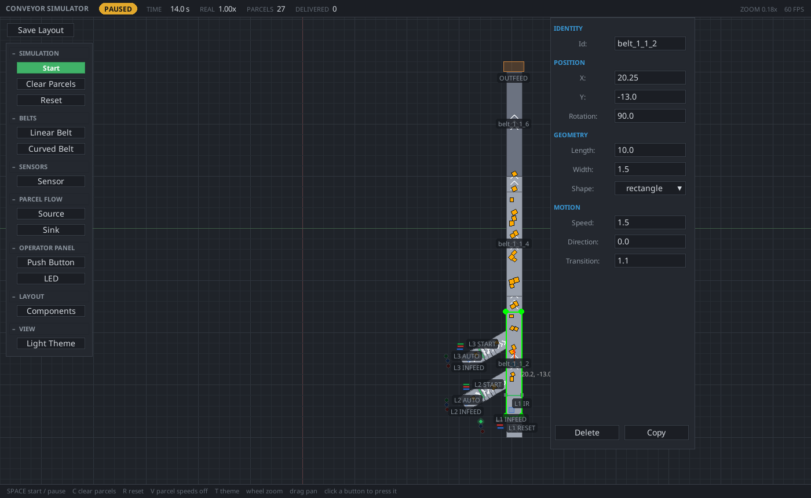
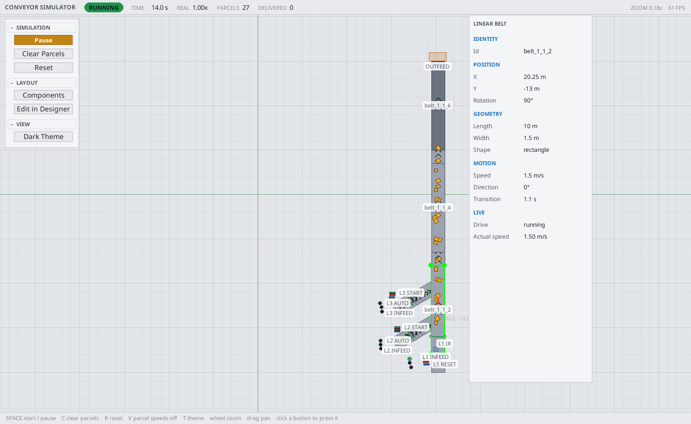

# Conveyor Flow Simulator - Python Engine

This directory contains the Python physics engine, visualizer, and PLC data-exchange
layer for the Conveyor Flow Simulator. It works in tandem with the React-based
frontend editor to simulate physical interactions between parcels, conveyor belts,
and sensors, and to exchange live I/O and metrics with a real or mock PLC over
MQTT or TCP.

## Architecture

The Python simulation runs as a standalone process that:
1. Parses a JSON configuration file generated by the React editor (`config_parser.py`).
2. Runs a 2D rigid-body physics simulation using Pymunk (`physics.py`).
3. Renders the simulation in a standalone window using Pygame (`visualizer.py` &
   `editor_ui.py`). Layouts are designed in the separate Qt layout editor
   (`layout_editor.py`, see [Designing layouts](#designing-layouts)).
4. Evaluates sensor triggers and drives kinematics (belts moving parcels).
5. Optionally exchanges I/O and metrics with a PLC (real or mocked) over MQTT or
   framed TCP, and optionally serves a browser-based editor + live dashboard for
   that exchange (see [Channel Registry Web UI](#channel-registry-web-ui) below).

### File Structure

**Core simulation**
- `main.py` - Entry point. Loads the config, builds the physics engine and the
  MQTT/TCP exchange engine, optionally starts the web UI, then runs the pygame
  GUI loop (or a headless loop).
- `physics.py` - The core Pymunk simulation. Handles belt kinematics, vertex-based
  impulse application, parcel collision, and sensor state evaluation.
- `machines.py` - Pallets, stoppers, robot arms and elevators, and floor
  levels (see [Machines](#machines-pallets-stoppers-robot-arms-elevators)).
- `logistics.py` - Parcel identity, scanners, diverters, turntables,
  accumulation, chutes, guard doors and safety relays (see
  [Logistics equipment](#logistics-equipment-identification-sorting-accumulation-safety));
  `logistics_draw.py` draws them in the simulator window.
- `robot6.py` - 6-axis robot kinematics (FANUC-style geometry, closed-form
  inverse for a downward tool); `heights.py` - floor levels, conveyor and
  part heights shared by the robots and the 3D view.
- `scene3d.py`, `view3d.py`, `view3d_web/` - The 3D view of the running
  simulation in the browser (see [3D view](#3d-view)).
- `visualizer.py` - The Pygame rendering loop. Draws belts, sensors, parcels, and
  selection highlights based on the simulation state.
- `editor_ui.py` - The Pygame GUI panel for viewing read-only properties of the
  selected component.
- `layout_editor.py` - PySide6 layout editor (design time only): Shape Designer,
  component library, alignment guides, undo/redo, copy/paste. Opens and saves
  layout JSON; does not run the simulation.
- `config_parser.py` - Loads the JSON config and deserializes it into typed Python
  dataclasses.
- `math_utils.py` / `id_utils.py` - Geometry helpers (e.g. ray casting for
  `point_in_polygon`) and crash-proof "next id" generation for new components.

**PLC data exchange (MQTT/TCP)**
- `mqtt_data_exchange.py` - `MQTTSyncEngine`: publish (simulator -> PLC) and
  subscribe (PLC -> simulator) channels, plus the hardcoded
  `PUBLISH_TOPICS`/`SUBSCRIBE_TOPICS`/`METRICS_CHANNELS` channel definitions used
  when no channel registry file is given.
- `mqtt_manager.py` - Thin MQTT client wrapper (`paho-mqtt`).
- `tcp_framed_transport.py` - The framed-TCP alternative transport (`FrameType`
  enum + length-prefixed frame read/write) for deployments without an MQTT broker.
- `mqtt_message_binding.py` - `ComponentMessage`/`MetricsMessage` binary
  packing/unpacking, and `custom_component_mapping()` (component id -> ByteType +
  padding), the single source of truth both the CLI tools and the web editor use.
- `metric_layout.py` - metric frame layouts as nested `@dataclass`es (one class
  per metric group, field widths via `f32`/`u16`/`u32`/`Vec2`/... aliases);
  `layout_mapping()` derives the wire `(ByteType, "group/name")` list
  `MetricsMessage` consumes. `mqtt_data_exchange.py`'s `METRICS_CHANNELS` declares
  each layout as one of these classes (`MetricLayout1`, ...).
- `mqtt_message_codec.py` / `struct_utils.py` - Lower-level struct pack/unpack
  helpers shared by the binding layer.
- `channel_registry.py` - Loads IO-mapping/metric channel definitions from an
  external `channels.json` instead of the hardcoded dicts in
  `mqtt_data_exchange.py`. Fully additive - only used when `--channel-registry`
  is given.
- `mqtt_data_exchange_codegen.py` - Reads and rewrites the hardcoded
  `PUBLISH_TOPICS`/`SUBSCRIBE_TOPICS`/`METRICS_CHANNELS` definitions in
  `mqtt_data_exchange.py` in place (metric layouts regenerated as `@dataclass`
  blocks) - the write path the web editor uses when no registry file is
  configured.
- `generate_frame_type.py` - Appends a new `FrameType` enum member to
  `tcp_framed_transport.py` for a metric channel's `frame_type` that doesn't have
  one yet, instead of hand-editing the enum.
- `validate_channel_registry.py` - CLI: check a `channels.json` (and the CSVs it
  references) against a simulator config without starting the simulator.
- `bootstrap_channel_csv.py` - CLI: generate a valid channel mapping CSV from a
  list of component ids.

**Live metrics dashboards**
- `metrics_store.py` - Thread-safe, bounded, grouped storage for client-reported
  metrics, fed by the exchange engine and read by the web dashboard below.
- `web_app.py` + `web_static/` - A Flask app serving the
  channel registry editor and a live metrics dashboard. See
  [Channel Registry Web UI](#channel-registry-web-ui).

**Test client**
- `plc_mock.py` - A mock PLC client for any layout over MQTT or TCP: runs the
  PLC program in `plc_logic.py` (Start/Stop buttons, parcel tracking, jam
  detection, belt speeds, LEDs) and reports its own measured performance as
  metrics - useful for exercising the Live Data tab below without real PLC
  hardware. Per-line control with feeder merges for multi-line layouts;
  `--bridge` also reports to the Foxglove middleware.
- `plc_foxglove_bridge.py` - Middleware: TCP server for the PLC's raw binary
  frames, decoded with the layout and published as JSON on a Foxglove
  WebSocket server (see "PLC data in Foxglove").
- `foxglove_ws_probe.py` - A minimal Foxglove WebSocket client (standard
  library) that prints what a Foxglove server publishes.

**Tests**
- `test_*.py` - One file per module above (`unittest`-based). Run the whole suite
  with `python -m unittest discover -s . -p "test_*.py"` (or `uv run` in front of
  that, see below).

## Coordinate Systems Unified

The simulation bridges mathematical 2D space, Pymunk physics space, React/Konva
screen space, and Pygame screen space. To ensure components align perfectly across
all domains, a **Unified Coordinate System** is used.

### 1. World Coordinate System (Standard Cartesian)
All `x` and `y` coordinates defined in the configuration JSON are treated as
**World Coordinates**:
- **Origin `(0, 0)`**: Fixed reference point.
- **X-Axis**: Increases to the **Right**.
- **Y-Axis**: Increases **Upwards** (Standard Cartesian).
- **Angles**: `0` degrees points Right (+X). `90` degrees points Up (+Y).
- **Rotation Direction**: Positive angles rotate **Counter-Clockwise (CCW)**.

### 2. Pygame / Konva Screen Coordinate System
Both the React frontend (Konva) and the Python visualizer (Pygame) render to
screens where the Y-axis is inverted:
- **X-Axis**: Increases to the Right.
- **Y-Axis**: Increases **Downwards**.

### 3. Rendering Rotation Alignment
Because the Screen Y-axis is inverted relative to the World Y-axis, rotating an
object mathematically can be tricky. However, the system is perfectly unified
because of how Pygame and Konva handle rotation:

- **Pygame (`pygame.transform.rotate(surf, angle)`)**: Rotates a surface CCW on
  the screen. Because the screen Y-axis is Down, a CCW rotation on the screen
  effectively rotates the +X axis towards the -Y axis (Up). This exactly mirrors
  the World CCW rotation! Therefore, we apply the raw `rotation` value directly
  to Pygame surfaces.
- **Konva**: Rotates surfaces CW by default. The React frontend passes
  `-rotation` to Konva, which reverses it to CCW, making it perfectly align with
  both World and Pygame.

### 4. Bounding Boxes and Dimensions
- **Linear Belts**: Have `length` (width) and `beltWidth` (height). At
  `rotation = 0`, they are horizontally aligned along the X-axis.
- **Sensors**: Have `width` and `height`. At `rotation = 0`, if a sensor is
  defined as `width = 0.1` and `height = 1.0`, it acts as a tall, vertical
  bounding box aligned along the Y-axis.
- **Sensor Beams (Laser Banners)**: Laser beams are always distributed along the
  local Y-axis of the sensor. In World space, when `rotation = 0`, the local
  Y-axis points UP `(0, 1)`. When rotated by `angle`, the local Y direction
  becomes `(-sin(angle), cos(angle))` due to the CCW rotation matrix.

## Designing layouts

```bash
# Open an existing layout (or give a new file name to start from scratch)
uv run python layout_editor.py test_config.json
```

The Qt layout editor is where belt shapes and positions are designed:

- **Component Library** dock - a folder tree with a search box: drag a
  component onto the canvas to place it. Each one has a short description
  (tooltip, and the panel under the tree); the search box matches names and
  descriptions. Built in, by folder:
  - **Conveyors** - **Belts** (Linear, Curved), **Rollers** (Roller
    Conveyor, Curved Roller Conveyor, Accumulation Conveyor), **Transfers**
    (90° Transfer, Turntable, Elevator);
  - **Sensors** (IR, Laser Banner), **Identification** (Barcode Scanner,
    RFID Reader, DWS), **Sorting** (Pusher / Wheel Diverter, Chute),
    **Pallet Handling** (Pallet, Stopper), **Robots** (6-Axis Robot),
    **Parcel Flow** (Source, Sink), **Safety** (Guard Door, Light Curtain,
    Safety Relay), **Operator Panel** (Push Button, Emergency Stop, LED).

  Your own components are in **My Components**, in any sub-folders you like:
  - **Add Selected** saves the component selected on the canvas (any kind: a
    belt of any type or shape - e.g. one made from a DXF -, a sensor, a
    button, ...) as a reusable template, with its size, rotation, speed,
    colour and bindings, into the My Components folder that is current;
    **Update** overwrites the chosen template with the canvas selection;
    **Rename** / **Folder...** (move it, `Station 1/Lanes` for a sub-folder) /
    **Remove**. Right-click for the same. Built-ins can't be changed.
  - Your library is saved to `~/.conveyor_sim/component_library.json` after
    every change (or the file named by `CONVEYOR_COMPONENT_LIBRARY`) and is
    there again next time.
  - **Export...** writes your components to a library file, **Import...**
    adds the components of one (name clashes get a " (2)" suffix). The file
    format is in `component_library.py`.
  - **+ New Custom Shape...** opens the Shape Designer (freehand, triangle,
    quadrilateral or arc, with exact numeric parameters).
- **Alignment guides** snap to other components' vertices, edge midpoints and
  centers (also when rotated), plus a measure tool (D).
- **Component Manager** dock - the layout as a tree: a folder per kind
  (Belts, Sensors, Sources, Sinks, Buttons, LEDs) with its count, each
  component with its label and details (belt type and size, banner beams,
  button contact and key, ...). Selecting in the tree selects on the canvas
  and the other way round; double-click centres the view; filter box above;
  right-click to select, duplicate, delete or add to the library.
- Every command is an icon button on a tool bar (below); the menus hold the
  same actions: **File > Background (DXF)**, a flat **Tools** menu in
  sections (Sketch, Modify, Belts, Connections, then Check Layout - no
  sub-menus), **View > Show Ports** and **View > Panels** (show / hide
  every dock and toolbar).
- Undo/redo, copy/paste, rubber-band multi-select.
- The Properties dock is a property grid: a header with the kind, id and a
  one-line summary, then foldable sections (Identity, Position, Geometry,
  Motion, Signal, Operation, Display) with units on every number. Sensors
  expose on/off delay, light-on (NC) and bit/byte packing; buttons their type,
  NC contact and key; belts the speed or VFD command format.
- **PLC I/O** sections at the end of the property grid list the selected
  component's PLC signals as they are on the wire (`io_signals.py`, from
  the same mapping as the frames), each with its PLC type: **Commands (PLC
  -> simulator)**, such as a belt's `speed`, a stopper's `release` or a
  diverter's `divert`, and **Feedback (simulator -> PLC)**, such as a
  sensor's output, a belt's `actualSpeed` or a stopper's `isUp`. Use them to
  check the API before writing the PLC side. **Command source** (the
  component's `control`: `plc` or `manual`; a sensor `sim` or `manual`) is set here as part of the layout. The live values, and setting
  commands by hand, are in the simulator window's inspector (see below).
- **Run in Simulator** (toolbar, `F5`) shows the layout as it is on the
  canvas in the simulator **without saving it**: it writes a run copy to
  `<temp>/conveyor_sim_runs/` and runs that (`main.py <copy> --source
  <layout>`; **Edit in Designer** in the simulator then comes back to the
  layout file, not the copy). Save (`Ctrl+S`) when you want to keep the
  changes. There is one simulator window: if one is already running
  (started from here, or `python main.py` in a terminal), it reloads the run
  copy in place; otherwise `main.py` starts in its own window.
  The running simulator and designer are noted in `sim_instance.json` /
  `designer_instance.json` next to the settings file (`sim_link.py`).
- Dark and light themes: the toolbar button or **View > Theme**. The choice
  is shared with the simulator and remembered in
  `~/.conveyor_sim/settings.json` (or `$CONVEYOR_SIM_SETTINGS`).
- The same quiet style as the simulator. Canvas labels are upright tags
  of one small size at any zoom, shown only where they fit and never on top
  of each other (selected items first, then devices, then belt ids). Belt
  inlet/outlet markers are under View > Show Ports; connections are always
  marked (red when broken).


**CAD tools** (`layout_editor_cad.py` + the Qt-free `cad/` package):

| Action | Shortcut | What it does | Library |
|---|---|---|---|
| Tools > Connect Belts | Ctrl+J | Two belts selected: moves the downstream one so its inlet sits on the upstream outlet, heading continuous (tangent for curves) | planegcs |
| Tools > Fillet Belts... | Ctrl+Shift+F | Two straight belts: adds a curved belt of the given radius, tangent to both, trimming/extending the straights to meet it | planegcs |
| Tools > Disconnect Belts | Ctrl+Shift+J | Removes connections between the selected belts | |
| Tools > Solve Connections | F6 | Re-attaches every connection, holding the selected belts fixed | planegcs |
| Tools > Check Layout | F7 | Belt overlaps (transfer zones at belt ends are allowed), outlets leading nowhere, broken connections, sensors/sources not over a belt; double-click an issue to select it | Shapely |
| File > Import DXF Background... | | Floor plan as a locked background, via a dialog: units (prefilled from `$INSUNITS`, cross-checked against the drawing's dimensions), import only a window or one sheet of a drawing set, place it at the origin, leave out dimensions / hatches / leaders / layers | ezdxf |
| File > Background (DXF) > Place Background | Shift+B | Move the drawing: click its anchor point (snaps to the drawing), then where it goes (snaps to the layout and sketch, or type `x,y` / `@dx,dy`); the drawing follows the cursor. Or drag the **anchor** (the blue crosshair at the drawing's lower-left corner). One undo step; the file is not read again | |
| File > Background Settings... | | Change the background's units, window, offset and layers later (undoable) | ezdxf |
| File > Background (DXF) > Export Cropped DXF... | | Write the background's window, without what is left out, as a small DXF and optionally switch the background to it (undoable) | ezdxf |
| File > Export DXF... | | Layout in metres, one layer per kind (BELTS, BELT_CENTERLINES, FLOW, SENSORS, ...), with the background drawing as placed (window, filters, scale, offset) on BACKGROUND. Curved belt outlines keep true arcs, so a CAD tool - or a reimport - sees arcs; `test_dxf_workflow.py` checks the whole round trip (import, crop, draw, export, reimport, rebuild each belt from its outline) | ezdxf |
| View > Show Ports | | Inlet (green ring), outlet (orange arrow), connection (cyan ring; red = broken) | |

### CAD workflow: sketch (or import), then connect into belts


Tool bars - every command one click away, as an icon button; hover it for
its name and shortcut (the same actions as the menus). The icons are drawn
in code (`toolbar_icons.py`) and follow the dark / light theme:

- **Row 1**: **File** - Open, Save, Undo, Redo, Import DXF, Export DXF;
  **Background** - Place (move the drawing by its anchor, `Shift+B`),
  Settings, Crop (export the cropped DXF), Remove; **View** - Pan,
  Measure, Clear Measurements, Fit (zoom to the whole layout, `Z`), Ports
  (show belt inlets / outlets); **Run** in the simulator (`F5`) and the theme.
- **Row 2**: **Sketch** - Line, Arc, Arc Center, Rectangle, Circle,
  Polygon, Clear; **Belts** - Belt from Sketch, Roller from Sketch,
  Divide, Belt Path, Curved Belt, Outline Belt;
  **Connections** - Connect, Fillet Belts, Disconnect, Solve, Check
  (layout check, `F7`).
- **Left**: **Modify** (below).
- **Bottom**, full width like a CAD command line: the active tool's options
  (Width, Corner R, Arc method, Distance, ...) and the coordinate input -
  only what the tool uses, nothing while no tool is active.

Only Save As, the theme choice and the panels list are menu-only.

The mouse wheel zooms about the cursor: the point under it stays put,
anywhere on the canvas and at any zoom.

**Modify** (the vertical tool bar left of the canvas, or Tools > Modify)
edits sketch lines like a CAD tool; arcs stay exact, every action is one
undo step, points snap (OSNAP) and can be typed:

| Tool | Key | Use |
|---|---|---|
| Trim | `T` | click the piece to cut away - between the lines crossing it (other sketch lines and the background drawing); it shows red under the cursor first. Repeats until Esc |
| Extend | `E` | click near a line's end: it grows to the next line it meets (a line straight on, an arc round its circle) |
| Break | `K` | click a point on a line: it splits in two there (a closed shape opens) |
| Divide into Belts | `N` | click a line or arc, of the sketch or the background drawing. That piece (one segment) becomes **Parts** conveyors of equal length, each with its own drive, joined end to end: linear along a line, curved along an arc. Parts 1 makes the whole line or arc into one conveyor. **Surface** chooses belts or roller conveyors, **Direction** forward (as drawn) or reverse, and **Width** sets the width. The cuts and the flow show under the cursor first. Repeats until Esc |
| Offset | `Shift+O` | set **Distance** on the tool bar, click a line, then the side: a parallel copy (mitred corners, concentric arcs) |
| Fillet | `F` | set **Corner R**, click two lines on the sides to keep: they are joined with a tangent arc (R 0 = sharp corner) |
| Join / Explode | `J` / `X` | the selected lines joined end to end into one / split into single segments |
| Move / Copy | `M` / `Shift+M` | the selected lines: base point, then target (`@dx,dy` works); Copy places copies until Esc |
| Rotate | `R` | the selected lines: centre, then the angle's direction - or type the angle (`90`) |
| Mirror | `I` | the selected lines: two points of the mirror line; **Keep originals** on the tool bar |
| Scale | | the selected lines: base point, then type the factor (`2`) or click at that distance |

`Ctrl+C` / `Ctrl+V` / `Ctrl+X` copy, paste and cut sketch lines and
components together (pasted at the mouse, keeping their layout).

**Grips**: select sketch lines (up to 10) and handles appear on them. Drag a
handle to edit the line in place; it snaps like the drawing tools, and each
drop is one undo step:

- **Line / polyline**: the white squares on the end points and vertices move
  that point. An arc next to a moved vertex bends so it still passes through
  its own middle. The blue square in the middle of a straight segment moves
  the segment parallel. On an arc segment, that middle square bends the arc
  through the dragged point.
- **Arc**: the end points; the orange **center**, which moves the arc; and the
  yellow middle of the arc, which changes the **radius** while the center and
  angles stay the same.
- **Circle**: the orange **center**, which moves the circle; and the four
  yellow quadrant points, which change the **radius**.

With exactly one sketch entity selected, the **Properties** panel shows its
numbers to type:

| Entity | Fields |
|---|---|
| Line | start X/Y, end X/Y, length and angle (the start stays put) |
| Arc | center X/Y, radius, start angle and sweep (+ = counter-clockwise) |
| Circle | center X/Y and radius |
| Polyline | each vertex X/Y (the first 100) |

1. **Geometry first**, like any CAD tool:
   - **Sketch Line (S)** draws construction lines and tangent arcs (L / A),
     and **Sketch Arc (Shift+S)** draws an arc, by the toolbar's **Arc**
     method:
     - *3 points*: the start, the end, then a point the arc passes through;
     - *Center, start, end*: the center, the start (sets the radius), then
       sweep round and click the end - the way you sweep sets clockwise or
       counter-clockwise, and it may go past half a turn. A typed end point
       goes counter-clockwise. **Arc (Center, Start, End) (Shift+A)**
       starts the arc tool with this method chosen.
   - Basic shapes: **Sketch Rectangle (Shift+R)** (two corners),
     **Sketch Circle (Shift+C)** (center, radius) and **Sketch Polygon
     (Shift+G)** (center, a corner; toolbar Sides). Corner R rounds the
     rectangle's and polygon's corners. Loop conveyors are built from these:
     sketch the shape, then make a belt along it or filling it (step 3).
   - Or **File > Import DXF Background...** a plant layout. Its lines, arcs,
     circles and polylines are read exactly (with arc bulges). Real drawings
     often need fixing on the way in, so the import dialog shows a preview
     and:
     - **Units**: m / cm / mm / inch / ft / unitless (typed scale), prefilled
       from `$INSUNITS`. The dimensions cross-check it: e.g. a dimension
       measuring 0.85 units shown as "85" (DIMLFAC 100) means metres drawn,
       centimetres shown, so a header saying inches is flagged (Use m).
     - **Import only a window**: pick a sheet (paper frames found in the
       drawing, named after their titles, or groups of geometry far apart)
       or drag a rectangle on the preview. Only geometry inside is loaded,
       which keeps a big drawing set fast.
     - **Placement**: the window's lower-left at (0, 0), or pick an origin
       point, or type the offsets. The result's size in metres is shown.
     - **Leave out** dimensions, hatches and leaders, and hide layers. What
       is left out is not drawn, snapped to or picked.
     - **Export Cropped DXF...** (under the window choice) writes the window,
       with what is left out removed, as a new DXF: blocks expanded, lines cut
       at the window edge, arcs kept exact, same units, layers and
       coordinates (or **Move to (0, 0)**), texts inside kept. It then offers
       to use the cropped file as the background - placement stays the same,
       and a 20 MB drawing set becomes a file of a few hundred KB that opens
       instantly in the editor, the simulator or any CAD tool.

     The choices are saved in the layout's `background` (`scale`, `offsetX`,
     `offsetY`, `clip`, `skipTypes`, `hiddenLayers`); change them later with
     File > Background Settings...
2. **Every point you place snaps to existing geometry (OSNAP)**, on the
   drawing, the sketch and components. A yellow marker shows the snap before
   you click: Endpoint, Center, Midpoint or Nearest (on an edge), else Grid.
   The OSNAP toolbar button turns it off. Shift snaps the angle to 15 deg;
   typed `x,y`, `@dx,dy` and `len<angle` give exact points. A free click is
   only pixel-accurate, so type or snap points that must be exact.
3. **Connect geometry into a belt with Tools > Belt from Sketch/Drawing (B)**:
   - Click **on a line or arc** for a belt along it *and every line/arc
     joined to it end to end*, in any drawing direction (a branch stops the
     chain). The belt width comes from the toolbar's Width.
   - Click **inside a closed area**, even one bounded by separate lines, for
     a belt filling exactly that area (any shape, like a skewed merge
     feeder).
   - The toolbar's **Type** chooses the belt, and the preview shows it before
     you click:

     | Type | On a line / arc | In a closed area |
     |---|---|---|
     | Auto | straight -> Linear, an arc or circle -> Curved, anything else -> Path | arc-shaped -> Curved, else Linear |
     | Linear | a rectangle belt along a straight line | a polygon belt with that outline; parcels move one way |
     | Curved | a curved belt along an arc or circle | a ring sector, ring or disc bounded by concentric arcs, filled by a curved belt (parcels turn about the center) |
     | Path | a path belt along the whole chain | the middle arc of an arc-shaped area |

     **Direction** sets where parcels go, shown by the preview's arrows:
     Forward (along the line in its drawn order; in an area along its long
     axis, or counter-clockwise for curved), Reverse, or Across +/-90 deg
     (linear only). It can still be changed in Properties afterwards.
   - **Roller conveyors from the drawing**: **Tools > Roller from
     Sketch/Drawing** (`Ctrl+Shift+B`) is the same tool with **Surface**
     set to Roller. You can also switch **Surface** in the option bar.
     - It makes driven roller conveyors (0.125 m pitch, 0.3 m/s, as in the
       catalogue) instead of belts.
     - A roller conveyor is straight or curved: a straight line or a
       rectangle makes a straight one, an arc, circle or arc-shaped area a
       curved one.
     - A chain that would become a path belt is refused, with the reason.
       Pick a straight piece or an arc, or set Type to Linear / Curved.
   - **Shapes split into parts**: line ends that miss each other by up to
     the toolbar's **Join gap** (default 2 cm) count as joined, both for
     lines and for closed areas, and a line drawn twice on top of itself
     doesn't stop a chain. When what you mean is still split (an area cut
     by a line, a chain through a branch), **Shift+click** each piece and
     press **Enter** for one belt: areas are merged, lines joined. Esc
     clears the pieces.

Sketch geometry is saved in the layout (`sketch`), exported to DXF on the
SKETCH layer, and ignored by physics. Select a sketch line and press Delete
to remove it, or use Tools > Clear Sketch. Shortcuts that skip the sketch
step:
- **Draw Curved Belt (U)**: an arc by either Arc method (3 points, or
  center, start, end) for a real curved belt - parcels turn about the
  arc's center, from the start towards the end. The toolbar's Width sets the
  belt width; the preview shows the band with its radius, sweep and CW / CCW.
- **Draw Belt Outline (O)**: click the corners of any polygon. The first edge
  sets the flow direction.
- **Draw Belt Path (P)** (below).

Selecting a polygon belt shows its corner handles: drag one to move it,
Shift+click to insert a corner, Alt+click to delete one.

### Drawing belts (path belts)


**Tools > Draw Belt Path (P)** draws a belt along any path:

| Input | Effect |
|---|---|
| click | add an anchor (snaps to component key points and the grid) |
| Shift | segment angle snaps to 15 deg steps |
| L / A (or the toolbar) | following segments are straight lines / tangent arcs |
| typing `x,y` `@dx,dy` `len<angle` `len` + Enter | exact anchor (absolute, relative, polar, or along the cursor direction) |
| click the first anchor (or C) | close the path into a loop conveyor |
| Enter / right-click / double-click | finish an open path |
| Backspace / Esc | remove the last anchor / cancel |

The live preview shows the belt surface, the current segment's length and
angle, and the total length.

With **Separate belts** (toolbar, on by default) the finished line becomes
one belt per section, each with its own motor (drive, VFD channels): a
linear belt for every straight run and a curved belt for every curve -
tangent arcs and rounded corners alike. They are joined in flow order (a
loop all the way round), so Check Layout and the editor keep them connected,
and parcels ride from one to the next. A curve tighter than half the belt
width is refused with a hint (raise Corner R or narrow the belt) and you
keep drawing. Undo removes the whole line in one step. Turn it off for a
single path belt with one motor:

Sharp corners are rounded with the toolbar's
**Corner R** (0 = keep them sharp, mitred). The rounding is part of the belt
(`cornerRadius`, also in Properties), not baked into extra anchors: the
anchors stay the corners you clicked, so dragging one re-rounds that corner
and the belt stays smooth.
For loops of standard shapes, sketch a rectangle, circle or polygon and
use Belt from Sketch/Drawing with Type Path (on its outline) instead.

Select a drawn belt to edit its anchors: drag a handle to move it,
Ctrl+click to switch the segment after it between straight and tangent arc,
Shift+click to insert an anchor, Alt+click to delete one. Everything is undoable.

How it's stored and simulated (`cad/path.py`): a path belt is `type: "path"`
with `path: [{x, y, bulge}, ...]` (local to the belt's `x`/`y`/`rotation`) and
`closed`. `bulge` is the DXF polyline convention (0 = straight,
tan(sweep/4) = arc), so arcs are exact and export to DXF as native bulge
polylines. The belt surface is the centerline offset by half the belt width
on each side (Shapely); a loop is a ring. In the simulator, a point on the
belt moves along the nearest centerline piece at belt speed, and arc pieces
turn rigidly about their center like a curved belt, so parcels keep their
orientation through curves (kinematic and friction traction). The layout
check flags curves tighter than half the belt width. Path belts can't be
used with Connect/Fillet (the constraint solver handles straight and curved
belts); draw the joint into the path instead.

Connections are saved in the layout (`connections`) and kept while editing:
dragging a belt moves every belt connected to it, in the same undo step. The
background reference is saved as `background` (`path` relative to the layout,
`scale` in metres per drawing unit, `offsetX`/`offsetY` in metres).

File > Save writes back to the opened file and keeps everything the editor
doesn't edit (drive settings, `tractionModel`, exchange settings). Then run it:
`python main.py <layout.json>`. The editor doesn't run the simulation itself:
its per-frame rendering of moving parcels measured ~9x slower than pygame's
(22.8 ms vs 2.6 ms), so the simulator runs in the pygame app.

## Running the Simulation

```bash
# Pygame GUI, with a specific configuration file
python main.py test_config.json

# Headless (no window at all)
python main.py test_config.json --headless
```

**Nothing moves without a PLC.** The simulator is the plant. It starts with
every command the PLC gives at rest: belts and rollers stopped, machines
idle, lamps off. They move when a PLC commands them: the mock PLC
(`plc_mock.py`, see [Mock PLC client](#mock-plc-client)) or a real one over
the same exchange. Parcels still appear at their sources. To drive one
component without a PLC, set its source to `manual` in the inspector (PLC
I/O).

```bash
# The simulator with the TCP exchange, then the mock PLC (--autostart: Start at once)
python main.py machines_demo.json --exchange-config tcp_exchange_config.json
python plc_mock.py machines_demo.json --exchange-config tcp_exchange_config.json --autostart
```




The window follows an operator-panel style (`hmi_style.py`, shared with the
layout editor): a quiet grey canvas, colour only for state - green running /
clear, red blocked / fault, amber paused. The status bar shows run state,
simulated time, the real-time ratio, parcels in flight and delivered, drive
faults and the PLC link (`PLC 1 link`, or `LAYOUT mismatch` when its frames
don't fit). Running belts show flow chevrons; a tripped drive gets a red
outline and a FAULT tag. Labels are small, upright tags placed by priority
(faults, then devices, then belt ids); a label that would overlap another is
left out until you zoom in, and the selected item always shows its tag and
coordinates. `V` toggles the per-parcel speed readout (actual / belt speed).
The simulator runs and watches a layout; it does not edit it. Layouts are
designed in the layout editor, and **Layout > Edit in Designer** opens the
current layout there (save, then **Run in Simulator** in the editor to see
the change). Like the simulator, there is one designer: if one is open, it
comes to the front with this layout (opening it in place of another layout,
asking first about unsaved changes) instead of a second one starting. The tool bar under the status bar holds every command in
three groups: Simulation (Start / Pause, Clear Parcels, Reset), Layout
(Components - the layout as a tree, a folder per kind - and Edit in
Designer) and View (Hide / Show Drawing, theme). The layout's DXF background
is drawn behind the belts as in the editor (same window, filters, scale and
offset); it is cached as an image, so panning a large drawing stays smooth. Clicking a component shows it in the read-only
inspector on the right (the editor's sections, wording and units) with a
**Live** section: drive state and actual speed for a belt, blocked / clear
(or blocked beams) for a sensor, the contact for a push button, the lamp for
an LED. Dragging on the canvas always pans the view.

The inspector also has the component's **PLC I/O**: its PLC commands and
feedback by name (`io_signals.py`), with their values live. The panel
scrolls with the mouse wheel when they don't fit.

- **Command source** buttons: `plc` (the PLC data exchange) or `manual`;
  a sensor has `sim` or `manual`. Click one to
  switch the running simulation, even while it runs.
- In `manual` the commands become controls: an ON / OFF toggle for a BOOL,
  a text box for a number (type it, then Enter). PLC frames leave that
  component alone, so you can drive one machine by hand while the PLC runs
  the rest. For example, run a wheel diverter (`divert`) at the speed and
  direction you type (`commandSpeed`, `commandAngle`), run a belt, or
  release a stopper. A sensor in `manual` is forced: its output is what you
  set, parcels or not.
- Shortcuts (Space, R, C, ...) pause while a text box has the keyboard.
- The source you click here applies to this run only. To keep it, set
  **Command source** in the designer.

| Control | Key | Does |
|---|---|---|
| Simulation > Start / Pause | `Space` | run or pause the physics (green Start, amber Pause) |
| Simulation > Speed | `[` `]` | 1x / 2x / 4x / 8x / MAX (as fast as possible); the window keeps its own frame rate |
| Simulation > Clear Parcels | `C` | remove every parcel, keep time and drives running |
| Simulation > Reset | `R` | clear parcels, time, counters, sensor filters and drive state |
| View > Hide / Show Drawing | `D` | the layout's DXF background (disabled when the layout has none) |
| View > Light / Dark Theme | `T` | switch palette (shared with the editor, remembered) |
| Layout > Edit in Designer | | open this layout in the layout editor |

Add `--exchange-config <file.json>` to override the MQTT/TCP settings baked into
the workspace config (see `tcp_exchange_config.json` for the shape).

The simulation runs in its own process, decoupled from the window
(`sim_process.py`): physics, the PLC exchange (its TCP server - the PLC
connects to that process) and, with `--web-ui`, the web dashboard tick every
2 ms of wall time on a CPU core of their own (`sim_runner.py`), while the
window only draws, at `--render-fps` (default 30). Each frame the window
takes one snapshot - parcels, belt / sensor / lamp / button states - and
sends play, speed, button presses, Clear and Reset back. A slow frame - lots
of parcels, a big drawing, dragging the window - never slows the simulation
down, and a 10 ms exchange channel really goes out every 10 ms. On Windows
the process opts out of power throttling (a process without a window of its
own is otherwise run as background work, measured ~20 % slower).
`--no-sim-process` keeps the simulation on a thread of the window's process
instead (it then shares the interpreter lock with the window: the window
holds it only while drawing the scene, a few ms per frame).

Speed: `--speed 1` (real time, default), `--speed 4` (four times faster), or
`--speed max` (as fast as the host can - physics runs flat out in 8 ms
slices, releasing the lock between them so the window and the PLC exchange
keep going); in the window the **Speed** button cycles 1x / 2x / 4x / 8x /
MAX and `[` / `]` step down / up. The status bar shows the speed asked for
and **REAL**, the speed reached over the last two seconds (amber when the
host can't keep up). For PLC tests keep 1x: the PLC's own timers (jam
time, scan) run on wall time.

```bash
python main.py test_config.json --speed max --render-fps 20
```

`--no-sim-process --no-sim-thread` steps physics once per frame instead (the
old behaviour; "max" is then 8x). `--headless` runs in one process, on the
simulation thread.

How many parcels run in real time: the physics takes 250 steps per simulated
second and its cost grows with the parcel count. `python bench_physics.py`
measures it on a synthetic plant (same physics settings as
`test_config.json`); on the development PC:

| Parcels | ms per step | Real-time factor |
|---|---|---|
| 100 | 0.75 | 5x |
| 200 | 1.5 | 2.6x |
| 400 | 3.2 | 1.2x |

The per-parcel geometry - which belts hold each parcel, laser banner beams,
IR sensor boxes - runs as compiled loops over all parcels at once
(`physics_kernels.py`, numba; compiled on first use and cached, so the very
first start takes a few seconds longer). They repeat the Python's
arithmetic exactly - a run gives the same numbers with or without them;
`CONVEYOR_SIM_KERNELS=0` switches them off. What remains per parcel is
pymunk's own Python layer (its velocity callback, position / velocity reads),
which is why the cost still grows with the parcel count.

### Belt drives, traction, and timing

See [drive_traction_plan.md](drive_traction_plan.md) for the design.

- **Fixed step.** Physics, drives and sensors advance in fixed `physicsDt` steps
  (default 4 ms) regardless of frame rate. Sensors count `risingEdges`, so the
  PLC can see a pulse shorter than the exchange interval.
- **Belt drive** (`drive.py`). The PLC's command is the setpoint. An optional
  `"drive": {"accel", "decel", "tau", "speedMax", "countsPerM", "maxLoad",
  "overloadTime", "atSpeedTolerance", "runningThreshold"}` turns it into
  `actualSpeed` (ramp + first-order lag), a UINT32 `encoderCount` that wraps
  and status bits. A belt without `drive` changes speed instantly, as before.
- **Traction** (`traction.py`). With `"tractionModel": "friction"`, parcels are
  dragged by friction capped at `Belt.friction` × m × g (`floorFriction` off belts),
  so starts, stops, slip and pushing come from physics. The default `"kinematic"`
  model is the original velocity-override behavior.
- **Belt feedback to the PLC.** Set `mqttSettings.beltFeedback: true` to publish
  every belt's status bits (`running`, `atSpeed`, `reversing`, `fault`), then per
  belt `actualSpeed` (REAL) + `encoderCount` (DWORD), in config order, as a
  `FrameType.BELT_FEEDBACK` (6) frame every `beltFeedbackIntervalMs`.
  It is off by default: the PLC must check the frame type byte before
  deserializing, or this frame overwrites its IO_MAPPING input struct.
  In channel registry files, a belt in an `"out"` (simulator → client) channel
  maps to these feedback fields, and `clock/simNanoseconds` gives simulated time.

### Field devices

How the simulated devices behave (`devices.py`, `drive.py`, `physics.py`):

| Device | Settings | Behaviour |
|---|---|---|
| IR sensor (`sensorType: "ir"`) | `onDelay`, `offDelay` (s), `invert` | 1 while a parcel is in the sensor's footprint (dark-on). `onDelay` ignores shorter blockages (flicker, gaps), `offDelay` stretches short pulses, `invert` gives a light-on / NC output (1 while clear). `risingEdges` counts detections. |
| Laser banner (`"laser_banner"`) | `laserCount`, `beamDistance`, the same timing / `invert` per beam | one bit per beam (beam *i* = bit *i*), each beam a segment across the sensor; `blockedBeams` (runtime) is how many are blocked - a parcel's size across the belt. |
| Push button | `buttonType` "momentary" / "latching", `normallyClosed`, `key` | Click (or hold its `key` in the simulator window) to press. Momentary: pressed while held; latching (selector, E-stop): toggles per press. An NC contact (STOP / E-stop) reads 1 until pressed. |
| LED | `packFormat` "bit" / "byte" | "bit": the PLC switches `isOn`. "byte": the PLC sends a mode - 0 off, 1 on, 2 blink 1 Hz, 3 blink 4 Hz. |
| Belt motor, command | `commandFormat` "speed" / "vfd" | "speed": `speed` (signed, negative = reverse) + `directionAngle` REALs. "vfd": `run` + `reverse` BOOLs and `speed` (REAL, magnitude), like a frequency converter. |
| Belt motor, feedback | `drive` (above) | `running`, `atSpeed`, `reversing`, `fault`, `actualSpeed`, `encoderCount`. **Overload**: parcels on the belt heavier than `maxLoad` kg for `overloadTime` s trip the drive - it coasts to a stop and resets when the run command is removed. A faulted belt has a red outline in the simulator window. |

`plc_mock.py`'s program (`plc_logic.py`) understands all of these: NC buttons,
light-on sensors, vfd belts, and a drive fault in the feedback stops the line
until it has reset and Start is pressed.

### Machines: pallets, stoppers, robot arms, elevators

`machines.py` runs them in the simulation; in the designer they are in the
library's **Pallet Handling**, **Robots** and **Conveyors > Transfers**
folders. Each stopper, robot arm and elevator has a `control` setting:

- `"plc"` (the default): it follows its command fields from the PLC
  (`plc_mock.py`'s program, `plc_logic.py`, or a real PLC). Without one, it
  does nothing.
- `"manual"`: it follows command fields you set by hand in the simulator
  window's inspector (PLC I/O); PLC frames leave them alone.
Its feedback fields go to the PLC either way. Layouts saved with the
former `"auto"` (a built-in controller) load as `"plc"`: that logic is
the PLC program's (`plc_logic.py`) now.

| Machine | Settings | Behaviour | PLC command / feedback |
|---|---|---|---|
| Pallet | `width` (along travel) x `height`, `mass`, `capacity`, `level` | Rides the belts like a parcel (same drive, sensors, collisions) and is never taken by a sink or Clear Parcels; Reset puts it back at its start. Its **load** rides on it: parcels a robot puts on it, or that a source makes right above it. A sink it crosses takes the load (counted as delivered) and lets the pallet go on. | - |
| Stopper | `width` across the belt, `depth`, `rotation` = the travel it stops, `actuationTime`; for the PLC program: `holdTime`, `releaseTime` | While up, a bar across the belt holds whatever arrives - typically a pallet before an intersection, a robot or a lift. It never rises under a pallet. The PLC program holds an arrival for `holdTime`, then lowers it for `releaseTime`. | `release` BOOL / `isUp`, `occupied` (something waiting) BOOLs |
| Robot arm | 6-axis robot on a pedestal at `x, y`: `reach`, `mountHeight`, `toolLength`, `pickX/Y`, `placeX/Y`, `pickRadius`, `cycleTime`, `speedOverride`, `pickLevel`, `placeLevel`, `placeTarget` "any" / "pallet", `pickSensorId` | A FANUC-style articulated arm (see [6-axis robot](#6-axis-robot) below). A cycle: above the pick point, straight down onto the part's top, grip (a pallet's load first, else a parcel), lift, carry, down onto the place point and let go - onto a pallet with room there, else (`placeTarget` "any") onto the belt / floor - and back to its perch. Its pick trigger is an external IR sensor at the pick point (`pickSensorId`, a sensor in the layout wired to the PLC): the PLC program starts a cycle when it is blocked and there is somewhere to put the part, and does not count a part waiting there as a jam. Without one, it uses the robot's own `partAtPick`. The designer shows its reach and the pick (green) / place (orange) points; dropping or pasting a robot moves them along. | see below |
| Elevator | footprint `width` x `height`, `beltId` (its platform belt: an ordinary belt on the footprint), `levels`, `levelHeight`, `liftSpeed`; for the PLC program: `autoFrom`, `autoTo` | A lift between floor levels. Whatever is on the platform - and the platform belt - travels with it and arrives on the new level. The PLC program: runs its belt until a part is on board at `autoFrom`, lifts it to `autoTo`, runs the belt until the platform is empty, and comes back. | `targetLevel` BYTE / `moving`, `atLevel`, `occupied` BOOLs, `level` BYTE |

#### 6-axis robot

The robot arm is a 6-axis vertical articulated robot with a spherical wrist,
like a FANUC M-10iA / M-20iA, scaled to its `reach` (`robot6.py`). Joints
use FANUC conventions: J1 heading, J2 upper arm from vertical, J3 forearm
from horizontal (absolute, the J2/J3 interaction), J4 to J6 the wrist, in
degrees. Inverse kinematics is closed form for the case conveyor robots
work in: the gripper pointing straight down, any yaw (elbow up, no wrist
flip).

The pick-and-place cycle (program 1) is a sequence of moves:
- a joint move to above the pick point;
- a straight-line move down onto the part's top, then grip;
- a straight lift, a joint move over the place point, and a straight move
  down onto the surface, then let go;
- a straight lift and a joint move back to the perch.

It takes `cycleTime` at 100 % `speedOverride`, gripping at 1/3 and letting
go at 2/3 of the cycle. A part's height comes from `heights.py`, the same
heights the 3D view draws, so the gripper meets each part's top.

PLC interface, like a FANUC controller's UOP signals:

| Direction | Signals |
|---|---|
| PLC -> robot | `enable` (ENBL), `start` (rising edge runs `program`), `hold` (*HOLD: motion pauses), `faultReset`, `gripperClose` (grip / let go under the tool, outside program 1) BOOLs; `program` BYTE (PNS: 1 pick and place, 2 go to the perch, 3 move the tool to the target), `speedOverride` BYTE (1..100 %), `targetX`, `targetY`, `targetZ`, `targetYaw` REALs (world m, deg) |
| robot -> PLC | `ready` (CMDENBL: enabled, no fault, idle), `busy`, `atHome` (ATPERCH), `inPosition`, `holding`, `partAtPick`, `placeReady`, `fault` BOOLs; `cycles` WORD; `faultCode` BYTE (1 out of reach); `j1`..`j6` (deg) and `tcpX`, `tcpY`, `tcpZ` (m) REALs |

`plc_logic.py` runs program 1 whenever a part and a place are ready, and
resets a fault with the line's Start / Reset.

Scripts (tests, scenarios) drive a robot directly. Moves are queued and run
in simulated time:

```python
arm = engine.machines.robot("robot_1")
(arm.move_to(1.2, 0.0, 1.4, yaw=0)            # joint move, tool down
    .move_to(1.2, 0.0, 1.05, linear=True)      # straight down
    .grip()
    .move_to(1.2, 0.0, 1.4, linear=True)
    .move_to(0.0, -1.2, 1.4, yaw=90)
    .move_to(0.0, -1.2, 1.05, linear=True)
    .release()
    .home())
engine.run_for(arm.remaining())
arm.joints, arm.tcp, arm.busy, arm.holding
```

`move_joints(q)` moves to joint angles. `move_to` raises
`robot6.Unreachable` for a point out of reach.

**Floor levels.** Belts, sensors, sources, pallets and stoppers have a
`level` (0 = ground):

- A belt moves only what is on its level, and a sensor sees only its level.
- Only bodies on the same level collide, so an upper conveyor can run
  above a lower one.
- In the simulator, upper-level belts are drawn over the lower ones with
  a blue outline, and so are parcels on an upper level.

A layout that uses only level 0 runs exactly as before; the physics is
bit-identical.

**PLC.** Machines join the generated I/O frames (`io_topics`):

- Feedback goes on input, after the sensors.
- Commands go on output, after the belts.
- The bits come first, as for every component (`MACHINE_FIELDS` in
  `mqtt_message_binding.py`).

`plc_logic.py` (the program `plc_mock.py` runs) drives `control: "plc"`
machines while the line runs. When
the line is stopped, every stopper stays up.

`machines_demo.json` uses all four:

- A pallet loop where a robot loads parts from a stopped feeder onto
  pallets held by a stopper. The loop is built like a real pallet line: four
  straight roller conveyors, with a 90-degree transfer at each corner that
  carries the pallet onto the next side without turning it. There are no
  curved belts.
- A sink that unloads the pallets.
- A lift that carries cartons up to a level-1 belt, which runs above a
  level-0 belt that never sees them.

```bash
python main.py machines_demo.json
```

`test_config.json` is Station_1 of the SIMATIC AX project: three lanes (an IR
sensor on lane 1, 32-beam laser banners on lanes 2 and 3) merging into lane 1
and the outfeed to `sink_4`; START / STOP / RESET buttons and AUTO / MANUAL /
ERROR LEDs per lane, with keys `1 2 3` (START), `q w e` (STOP), `a s d`
(RESET); the PLC-commanded belts have drive models with overload protection
and stand still until the PLC runs them. Its I/O frames are exactly the AX
project's `Station_1_Input` / `Station_1_Output`, so its belts use the
"speed" command format and `beltFeedback` stays off (the AX client
deserializes every frame as I/O). `test_fixture_config.json` is the old,
larger layout that unit tests use as a collection of every component variant.

To also start the channel registry editor + live metrics dashboard alongside the
simulator, add `--web-ui` (see [Channel Registry Web UI](#channel-registry-web-ui)):

```bash
python main.py test_config.json --web-ui
# with a channel registry file instead of the hardcoded exchange definitions:
python main.py test_config.json --channel-registry channels.json --web-ui
```

### Logistics equipment: identification, sorting, accumulation, safety

`logistics.py` runs these. They are in the designer's **Identification**,
**Sorting** and **Safety** library folders. Each device follows the PLC
(`control: "plc"`) or commands set by hand (`"manual"`); its feedback goes
to the PLC either way.
Like the machines, each one joins the generated I/O frames when a layout has
it (`MACHINE_FIELDS`).

**Roller conveyors.** A straight or curved conveyor with `surface: "roller"`
(and `rollerPitch`) is a driven roller conveyor, the usual way to move pallets.
It moves its load like a belt does. It is drawn as rollers in the simulator
window and the designer, and in the 3D view as steel rollers in side frames
that turn at the conveyor's actual speed (on a curve: tapered rollers on the
radii, between curved side frames). In the designer it is **Roller
Conveyor** / **Curved Roller Conveyor** in Conveyors > Rollers, or a belt's
**Surface** property.

**Diverters as machines.** A pusher is drawn and modelled as the real thing:
an actuator body on a stand beside the belt, on the side it pushes away
from, with two guide rods and a push plate. The plate sits at the belt edge
and sweeps across while the pusher is active, and a valve lamp lights. A
wheel diverter is a pop-up wheel module in the belt: a steel deck with rows
of rubber wheels that rise and steer to the divert angle while active (60
degrees at most), with its drive box and gear motor under the belt. The
designer, the simulator window and the 3D view all draw them from the same
dimensions (`equipment_geometry.py`).

**Parcel identity.** A source numbers its parcels (`barcodeStart`), gives
each a destination from `destinations` / `destinationWeights`, and a share
(`noReadRate`) with an unreadable label. Each parcel also gets a weight in
the source's mass range.

| Equipment | Set up | Does | PLC signals (in / out) |
|---|---|---|---|
| Scanner | zone over the belt, `scannerType` "barcode" / "rfid" / "dws" | Reads each parcel once as it enters. A barcode scanner gives a no-read on an unreadable label, RFID always reads, and a DWS (dimension-weight-scan) also measures the parcel | - / `code` UDINT, `destination` BYTE (as a warehouse system would answer), `readCount` UINT (+1 per parcel), `noRead`, `present`; DWS: `weight`, `measuredLength`, `measuredWidth`, `measuredHeight` REALs |
| Diverter | zone on the belt, `diverterType` "pusher" / "wheels", `divertAngle` (+-90 pusher, ~30 wheels), `speed`, `destination` | Steers the parcels in its zone onto the branch while active. The PLC program: active while a readable parcel for its destination is there. Following commands: active while `divert` is on, at `commandSpeed` m/s and `commandAngle` degrees exactly as commanded (both start at the layout's `speed` / `divertAngle`; `plc_mock.py` sends those) | `divert` BOOL, `commandSpeed` REAL, `commandAngle` REAL / `active`, `present`, `presentCode` UDINT, `diverted` UINT |
| 90° transfer | zone (`width` along the travel, `height` across), `crossAngle` (+90 left / -90 right), `speed`, `liftTime`, `stop` | The chain transfer of a pallet line, at a corner or junction of roller conveyors. A pallet stops centred on it (`stop`). Chain strands then lift it off the rollers and carry it sideways onto the crossing conveyor, without turning it, and drop. The PLC program: transfers whatever arrives (a corner) | `transfer` / `present`, `centered` (stopped on it, ready), `up`, `transferred` UINT |
| Turntable | `radius`, `beltId` (its platform belt), `angles`, `turnSpeed` | Turns its belt, and what is on it, between positions. The PLC program: loads at `autoFrom`, turns to `autoTo`, unloads, turns back | `targetIndex` BYTE / `index` BYTE, `turning`, `inPosition`, `occupied` |
| Accumulation conveyor | `beltIds` (its zones, in flow order), `mode` "singulation" / "train" | Zero-pressure accumulation, with a photo-eye at each zone's end. A full zone holds its belt while the next zone is occupied ("train": unless the next one is moving). The last zone discharges while released | `release` / `zones` UINT (bit mask), `full` |
| Chute | a sink with `capacity`, `emptyTime` | Holds `capacity` parcels, then is `full` and parcels back up in front of it. Emptied after `emptyTime`, or by `empty`. Only chutes go on the exchange, not plain sinks | `empty` / `count` UINT, `full` |
| Guard door | `width` | The operator opens and closes it: click it in the simulator or the 3D view. The PLC can lock it | `lock` / `closed`, `locked` |
| Safety relay | `stopButtonIds`, `doorIds`, `curtainIds` (sensors), `beltIds` (empty = all), `resetButtonId` | Stops its belts whatever the PLC commands when an e-stop is pressed, a door opens or a light curtain is broken. They stay stopped until every cause is clear and it is reset (its reset button or the PLC's `reset`) | `reset` / `ok`, `tripped` |

The PLC program (`plc_logic.py`) drives `control: "plc"` equipment:
- It tracks every scanner read (code to destination) and fires a diverter
  when the code in its zone is for that diverter's destination.
- It runs turntables: load at `autoFrom`, turn to `autoTo`, unload, turn back.
- It releases accumulation while the line runs.
- It empties a chute without an empty time a few seconds after it fills.
- It locks guard doors while the line runs, and resets safety relays with
  the line's Start / Reset.

`logistics_demo.json` is a scan-and-sort line:
- an induct with destinations 1-3 and 8 % no-reads;
- a three-zone accumulation conveyor and a DWS;
- a sorter with two pushers and a wheel diverter into three chutes;
- a turntable that sends the no-reads to a reject line;
- a guard door and an e-stop on a safety relay.

```bash
python main.py logistics_demo.json --view3d
```

The physics of layouts without this equipment is unchanged, bit for bit.

### 3D view

The running simulation in 3D, in a browser: the simulator window's
**3D View** button (VIEW group), or start with it:

```bash
python main.py machines_demo.json --view3d
```

The layout is built from what the designer placed on the 2D floor plan:
belts are their outlines extruded at conveyor height (0.75 m) on stands,
straight belts show chevrons that move at the belt's actual speed. The DXF
background lies on the floor. Sensors show their beams (red when blocked),
and stoppers rise and drop.

- **Control panels:** a line's operator buttons and lamps form one
  floor-standing console with a sloped desk. They are grouped when they
  are close together, or within 4 m and labelled for the same line ("L1
  START", "L1 AUTO"). Pilot lamps sit on the top row and pushbuttons below,
  with selectors and the emergency stop (a red mushroom on a yellow plate)
  at the bottom. Each device has a legend plate. The console faces the
  aisle. Click a button to press it, like in the 2D window.
- **Pallets** are EUR pallets (1200 x 800 x 144 mm, scaled to the pallet's
  size), with 5 deck boards, 3 cross boards, 9 blocks, 3 bottom boards and
  the fork openings between them.
- **Robots** are yellow 6-axis arms: a pedestal, the turret with its J1 and
  J2 motors, the upper arm, the elevated forearm, the wrist and a parallel
  gripper, moved by the robot's own joint angles. A beacon on the pedestal
  turns red on a fault.
- **Elevators** lift their platform belt between floor levels
  (`levelHeight` apart).

The physics stays 2D: belts move parcels on the floor plane exactly as in
the 2D window. The view adds the height. A parcel or pallet sits on its
level's belt top, a pallet's load on the pallet deck, a lift's riders on the
platform, and a gripped part hangs from the robot's tool centre point. Every moving part is sent with a full 3D pose (x, y, z, yaw)
and size, so machines that will really lift or carry things later (mobile
robots, lifting arms) only report a z; the viewer draws what it gets.

- Drag orbits, right-drag pans, the wheel zooms toward the cursor.
  **Fit** (F) frames the layout and **Top** (T) looks straight down.
  **Floor plan** (D) shows / hides the drawing and **Labels** (L) the names.
  Hover anything to see its name.
- The page is served by the simulator itself on 127.0.0.1, port 8765
  (`--view3d-port`). If another simulator already has that port, it takes a
  free one and prints the address (the 3D View button opens the right one).
  A page left open from an earlier run reloads the new layout once a new
  simulator serves it. Only a tab on screen streams the live state: a
  browser allows six connections to one server, so hidden 3D tabs let go
  of theirs, and a new tab still loads however many are open. `--view3d serve` serves without opening a browser,
  for `--headless` or a browser elsewhere through a tunnel. It uses no extra
  Python packages.
- three.js 0.160 comes from the jsDelivr CDN. On a PC without internet, unpack
  the npm package `three@0.160.0` into `view3d_web/vendor/three` and the page
  uses that copy instead.
- How it works: `scene3d.py` turns the layout (once) and the live state (~30
  times a second, only while a page is open) into 3D data. `view3d.py` serves
  the page, `/scene`, and `/events` (server-sent events). `view3d_web/viewer.js`
  draws it with three.js.

### Mock PLC client

A mock PLC for any layout, over the same TCP (or MQTT) exchange a real PLC
uses. It receives every button and sensor, runs a small PLC program
(`plc_logic.py`) and sends belt speeds and LEDs back, and reports its own
performance as metrics for the web dashboard:

```bash
python plc_mock.py test_config.json
```

The PLC program runs every `--scan` (default 50 ms). Which one depends on
the layout (`plc_logic.make_controller`, printed as `[PLC] Program: ...`):

**Line control** (`LineController`) for a layout with several lines - lines
are found from the names: labels like `L2 START` / `L2 BANNER`, or ids like
`belt_1_2_3` (station 1, line 2). `test_config.json` has a main line L1 to
the outfeed and feeders L2 and L3 merging into it, each with its own panel.
- **Per line**: START / STOP / RESET act on that line only. A feeder can only
  start while the line it feeds runs ("start L1 first").
- **Merging**: a feeder brings parcels up to its end sensor (the one nearest
  the main line) and **holds** them there - its belts stop - while the main
  line is stopped, jammed or faulted, or while the main line's sensor at the
  merge sees a parcel (the main line has priority). The hold latches (a
  parcel coasting past the sensor doesn't release it) and releases on its
  own when the main line moves and the merge is free. A held parcel is not a
  jam. Routine give-ways are counted (`L2 RUN (gave way 5x)`), not logged.
- **Jams and faults** stop only their line: a sensor blocked longer than
  `--jam-time` (default 5 s) while its line moves, or a tripped drive. Clear
  the parcel, then RESET and START.
- **Lamps** per line, by label: AUTO/RUN/OK = running, MANUAL/STOP/IDLE =
  stopped, ERROR/JAM/FAULT/ALARM = jam or drive fault, HOLD (if there is
  one) = holding at the merge.

**One line** (`DeliveryController`) otherwise:
- **Buttons** by label: START runs the belts, STOP stops them, RESET clears a
  jam (unlabelled: one button toggles; with two, the first starts and the
  second stops).
- **Sensors**: every parcel passing a sensor is counted; the sensor nearest a
  sink counts deliveries. A sensor blocked longer than `--jam-time` is a jam:
  belts stop until the parcel is gone and Start or Reset is pressed.
- **Belts** run at their speed from the layout file (1 m/s where it is 0)
  while running. **LEDs** by label: RUN (else the first LED) shows running,
  JAM/FAULT/ALARM (else the second) a jam.

Both: `--autostart` runs without pressing Start; belts run at their design
speed from the layout file (1 m/s where it is 0).

How the frames are built, and how to read and write them in `plc_mock.py`
and in a SIMATIC AX PLC (ST): [docs/plc-data-exchange-guide.md](docs/plc-data-exchange-guide.md).

### Complete logistics system (`logistics_full.json`)

One layout with every kind of machine, sensor and device, run by the mock
PLC. `tools/build_logistics_full.py` builds it from the two demos plus the
parts they lack, so rerun it after changing either demo.

- **Sorting line:** induct with a barcode scanner, three accumulation
  zones, a DWS, a laser banner, two pushers and a wheel diverter into three
  chutes, and a turntable sending no-reads to their bin. A guard door, a
  light curtain and the e-stop are on the safety relay.
- **Pallet loop (below):** a roller loop with four 90-degree transfers,
  pallets, stoppers, a 6-axis robot loading parts from its pick sensor,
  and an elevator to the upper level.
- **Tote line (above):** a roller conveyor, a curved roller conveyor, an
  RFID reader, a curved belt, and a sensor before the tote store.
- **Operator panel:** START, STOP, RESET and E-STOP buttons, and RUN and
  FAULT lamps.

Its exchange is on in the file: TCP on 127.0.0.1:5001.

```bash
python main.py logistics_full.json
```

```bash
python plc_mock.py logistics_full.json --autostart
```

**Checking the exchange.** `tools/verify_exchange.py` runs a layout end to
end: the simulator (headless) and `plc_mock.py`, each in its own process
on a free port. It then checks:

- the I/O layout handshake (LAYOUT_CHECK: the same frames on both sides);
- that frames flow both ways, with no size or decode errors on either
  side;
- that nothing moves before the PLC, and that afterwards belts run,
  parcels reach the chutes, scanners read, doors lock and the safety relay
  stays OK.

```bash
python tools/verify_exchange.py logistics_full.json --seconds 60
```

`test_device_kinds.py` also sends every field of both frames across and
compares them value by value.

**Seeing the frames.** `tools/frame_map.py` draws a layout's frames as a
byte and bit map, one colour per component, with each field's name, type
and offset on hover, and a table of where every component sits. It also
checks the mapping:

- the offsets add up to the packer's size;
- every field reads back at its offset, with an independent decoder;
- the generated PLC serializers' bytes decode in the simulator;
- each frame, with its 14 bytes of framing, fits the AX library's
  256-byte buffers.

```bash
python tools/frame_map.py logistics_full.json        # -> logistics_full.frame_map.html
```

**Adding a kind of device.** Every kind of machine and logistics device on
the exchange is declared once in `device_kinds.py`: its config list, model,
PLC commands and feedback, and the name of its PLC STRUCTs. The frames
(`io_topics`, in registry order), the component lookup, the inspector's PLC
I/O, the simulator window's mirror and `st_export.py`'s STRUCTs all derive
from it. The mock PLC's logic for each kind is one function registered with
`@device_program` in `plc_logic.py`. The steps are listed at the top of
`device_kinds.py`.

### PLC data in Foxglove (middleware)

`plc_foxglove_bridge.py` is a TCP server for the PLC: it receives the PLC's
raw binary frames (the same framing as the simulator link), decodes them
with the PLC's I/O layout (the layout JSON) and publishes JSON messages on a
[Foxglove](https://foxglove.dev) WebSocket server (`foxglove-sdk`), so you can
plot and inspect the PLC live.

```
simulator (main.py) <--TCP 5001--> PLC (plc_mock.py / AX PLC) --TCP 5002--> plc_foxglove_bridge.py --ws 8765--> Foxglove
```

| Topic | Content |
|---|---|
| `/plc/outputs` | per belt `speed`, `run`, `moving` (`reverse` for VFD belts); per lamp `on` + label |
| `/plc/inputs` | per sensor `blocked` (+ `beams`, `beams_blocked` for a laser banner); per button `pressed` (an NC contact already inverted); `image_age_ms` |
| `/plc/lines` | per line `state` RUN / HOLD / STOP / ERROR (`state_code` 2 / 1 / 0 / 3 for plots), `belts_moving`, `sensors_blocked` |
| `/plc/metrics/<layout>` | the PLC's metric frames (scan time, cycle time, ...) by group |
| `/plc/events` | `foxglove.Log`: layout check, line state changes, PLC sending / quiet |
| `/bridge/stats` | frames per type and node, frames/s, bytes, malformed frames, layout check per node |

Frames from the PLC (frame type byte in the header): `IO_MAPPING` = its
output image, `INPUT_IMAGE` (8) = the input image it works on (same layout
as the simulator's input frame), `METRIC_LAYOUT_n` = metrics, `LAYOUT_CHECK`
= answered like the simulator does. A real PLC sends its output STRUCT and
input STRUCT with frame types 1 and 8 (`python io_layout.py <layout> --st`
prints them).

**Run it** - in this order, each in its own terminal (PowerShell or bash):

```bash
# 1. the middleware: TCP 5002 for the PLC, Foxglove WebSocket on 8765
python plc_foxglove_bridge.py test_config.json --exchange-config tcp_exchange_config.json
```

```bash
# 2. the mock PLC, reporting to the middleware (no simulator needed: it keeps scanning)
python plc_mock.py test_config.json --exchange-config tcp_exchange_config.json --bridge 127.0.0.1:5002 --autostart
```

```bash
# 3. optional: the simulator, so sensors and buttons are live (start it before or after the PLC)
python main.py test_config.json --exchange-config tcp_exchange_config.json
```

Then in Foxglove: **Open connection** -> **Foxglove WebSocket** ->
`ws://localhost:8765`. Useful panels: **Plot** with
`/plc/lines.lines.L2.state_code`, `/plc/outputs.belts.belt_1_1_1.speed` or
`/plc/inputs.sensors.sensor_1_2_1.beams_blocked`; **State Transitions** with
`/plc/lines.lines.L1.state`; **Raw Messages** on any topic; **Log** on
`/plc/events`.

Without Foxglove, `foxglove_ws_probe.py` connects like Foxglove does and
prints what is published:

```bash
python foxglove_ws_probe.py ws://127.0.0.1:8765 --topic /plc/lines --seconds 5
```

Options: `plc_foxglove_bridge.py --listen 0.0.0.0:5002 --foxglove 127.0.0.1:8765`
(use `--foxglove 0.0.0.0:8765` to reach it from another machine);
`plc_mock.py --bridge HOST:PORT --bridge-interval 0.1 --node-id N`. On Git
Bash, topics starting with `/` are rewritten as paths before Python sees
them; the probe copes, or write `--topic plc/lines`.

### I/O frame layout

Each IO_MAPPING frame is a packed struct, no alignment, in the exchange's
byte order (`endianness`, LE by default). The layout follows the SIMATIC AX
serializer (`tools/generate_st_serde.py`): every single bit first, padding
to a whole byte, then every other field in declaration order.

| Field | Wire | PLC type |
|---|---|---|
| button, IR sensor, LED (`packFormat` "bit") | 1 bit, 8 per byte, bit 0 first | BOOL |
| padding | unused bits up to the byte | - |
| laser banner ("bit") | its beams, beam *i* = bit *i*, padded to whole bytes | BYTE / WORD / DWORD / LWORD, else ARRAY OF BYTE |
| `packFormat` "byte" / "uint16" / "uint32" / "float" | 1 / 2 / 4 / 4 bytes (a banner's beam *i* = bit *i* here too) | BYTE / WORD / DWORD / REAL |
| belt command (output) | speed, directionAngle: 2 x 4-byte float | ARRAY[0..1] OF REAL |
| belt feedback (BELT_FEEDBACK frame) | actualSpeed float, encoderCount uint32 | REAL, DWORD |
| clock | uint64 nanoseconds (wall clock) | LINT |

```bash
# Offset table (byte.bit, type, PLC type) of a layout's input and output frames,
# and the matching STRUCTs for the PLC project
python io_layout.py delivery.json --st
```

**The PLC side, generated.** `st_export.py` writes the whole AX side of
the exchange from this layout:
- STRUCTs per frame;
- serializers built from the exact byte and bit offsets, in the layout's
  byte order;
- a `SimIoContract` class with the frame magic, frame types, sizes and
  fingerprints;
- AxUnit golden-vector tests, which must reproduce the Python bytes;
- `io_contract.json`.

`--check` exits 1 when the generated files are stale, for an apax script or
CI. See [docs/plc-exchange-workflow.md](docs/plc-exchange-workflow.md) for
the evaluation and the workflow, including the existing
`generate_st_serde.py` and what the PLC side still needs.

```bash
python st_export.py delivery.json --out ../ax_dev/src/generated --tests-out ../ax_dev/test/generated --contract ../ax_dev/contract/io_contract.json
python st_export.py delivery.json --out ../ax_dev/src/generated --tests-out ../ax_dev/test/generated --check
```

**TCP robustness options** (`mqttSettings`, all off by default):

| Setting | Effect |
|---|---|
| `tcpRxTimeoutMs` | close a client that has sent nothing this long (0 = never) |
| `tcpMaxPayload` | don't send frames with a longer payload, counted in the stats (0 = no limit; the AX TcpClient takes 242) |
| `tcpOutputOwner` | take the PLC output frame only from this node id |
| `tcpRequireLayoutCheck` | take it only from a connection whose LAYOUT_CHECK matched |
| `tcpLengthEndianness` | byte order of the frame length field, when it differs from the payload's |

Changes that are always on:
- A LAYOUT_CHECK reply now goes only to the client that asked. A broadcast
  reply used to reach the PLC, which read it as its input image.
- The parser resynchronizes without losing frames, and accepts empty ones.
- Sockets use `TCP_NODELAY` and keep-alive.

The simulator prints each channel's size and layout fingerprint (a CRC-32
of offsets, types and names) when it starts - `main.py --show-layout`
prints the full tables - and `plc_mock.py` prints its own
(`--show-layout` for tables and STRUCTs). When `plc_mock.py` connects over
TCP it sends a LAYOUT_CHECK frame (frame type 7) with its fingerprints; the
simulator compares them with its own and both log `I/O layout check: OK` or
a MISMATCH naming the frame (input/output) and both sizes. Frames of the
wrong size are ignored, counted (`rx_size_errors` in the exchange stats)
and reported every few seconds, never applied.

### Workflow: a parcel delivery line, designed to controlled

1. `python layout_editor.py delivery.json` - File > Import DXF Background...
   the hall plan (units, one sheet, origin); place linear and curved belts,
   IR sensors, a Parcel Source, a Sink, Push Buttons labelled START / STOP
   and LEDs labelled RUN / JAM from the Component Library; set the belts'
   design speed in Properties; save.
2. `python main.py delivery.json --exchange-config tcp_exchange_config.json`
   - the simulator, serving the I/O over TCP.
3. `python plc_mock.py delivery.json --exchange-config tcp_exchange_config.json`
   - the PLC: it prints its inputs, outputs and which button/LED does what.
4. Click START in the simulator window: the belts run, and the PLC log shows
   each parcel at each sensor and the deliveries. STOP stops the line.

No channel setup is needed: a layout that doesn't have `test_config.json`'s
component ids gets its I/O image from its own components
(`mqtt_data_exchange.io_topics`): input = every button, every sensor, the
clock; output = every LED, every belt - the simulator and `plc_mock.py`
build the same one. `test_delivery_workflow.py` runs this whole workflow,
with the real `plc_mock.py` process, as a test.

### Standalone validation/codegen tools

These work directly on a `channels.json` + CSVs, without starting the simulator
or the web UI - the same checks/output the web editor uses under the hood:

```bash
# Check a registry (and the CSVs it references) against a config
python validate_channel_registry.py --registry channels.json --config sim_config.json

# Generate a starting CSV for a new channel from a list of component ids
python bootstrap_channel_csv.py --config sim_config.json --ids belt_1,sensor_1 --out channels/new_channel.csv
```

## Channel Registry Web UI

`web_app.py` serves a browser-based editor for the simulator's PLC I/O-mapping and
metric channels, plus a live view of whatever metrics a connected client (the
simulator itself, or `plc_mock.py`) is reporting - replacing hand-edited
JSON/CSV/Python dicts and a separate CLI validate step with immediate, per-row
feedback as you type. Every check it reports comes from the exact same functions
the CLI tools and `MQTTSyncEngine` itself use (`verify_component_list`,
`parse_mapping_rows`, `channel_registry.validate_entries`) - the browser is
presentation only, never a second implementation of what's valid.

### Starting it

```bash
# Embedded: alongside a running simulator, sharing its live MetricsStore
python main.py test_config.json --web-ui --web-host 127.0.0.1 --web-port 5050

# Standalone: registry editor only, no live simulator/metrics
python web_app.py --config sim_config.json --registry channels.json
```

Then open `http://127.0.0.1:5050` (or whatever `--web-host`/`--web-port`, or
`web_app.py --host`/`--port`, you gave it).

`--web-host`/`--web-port` default to `127.0.0.1:5050`; bind `--web-host 0.0.0.0`
to reach it from another machine on the network.

### Two channel-definition sources

- **`--channel-registry channels.json` given**: the editor reads/writes that file.
  Missing it creates a new one on first save; nothing else on disk is touched.
- **`--channel-registry` omitted**: the editor reads/writes the hardcoded
  `PUBLISH_TOPICS`/`SUBSCRIBE_TOPICS`/`METRICS_CHANNELS` dicts directly in
  `mqtt_data_exchange.py` (via `mqtt_data_exchange_codegen.py`). Saving rewrites
  that file in place - the **previous version is always backed up as
  `mqtt_data_exchange.py.bak`** first, and the new source is compiled and
  re-validated (`validate_entries`) before anything is written, so a bad edit
  never reaches disk. Either way, **the running simulator process (and any other
  already-running one) needs a restart to pick up the change** - Python doesn't
  hot-reload a module it already imported.

### Channels tab

- Pick an existing channel from the list on the left, or **+ New** to start one.
- **`io_mapping`** channels use the component picker: add component ids from the
  current config's catalog (sensors, buttons, LEDs, belts, the shared `clock`) and
  reorder them with the up/down arrows - the server decides each one's `ByteType`
  and any padding from its own `packFormat`, the same way the CLI tools build it.
  Nothing in the rows table is hand-edited here.
- **`metric`** channels are hand-authored: **+ Add row** appends a field (`Group`
  is what the Live Data tree branches on, `Type` is the PLC-style register width
  it packs as on the wire). A run of `BIT` rows auto-shares one byte. In hardcoded
  mode, saving regenerates the channel as a nested `@dataclass` metric layout in
  `mqtt_data_exchange.py` (`metric_layout.py`) - one class per `Group`, one typed
  field per row; `plc_mock.py` fills an instance of that class and hands it
  straight to `MetricsMessage.serialize()`.
- The status line below the fields shows per-row validation errors live, or the
  final payload size once the channel is valid. An "unknown frame_type" error
  comes with a **Generate FrameType** button that calls `generate_frame_type.py`
  for you.
- **Save registry** writes every channel at once (only if every channel is valid)
  - see backup/restart notes above for what "save" actually does in each mode.

### Live Data tab

- The metrics tree on the left lists every group/metric the connected client has
  reported so far (empty, with a "No live simulator connected" notice, if nothing
  is feeding the shared `MetricsStore` - run the simulator with `--web-ui`, or
  point `plc_mock.py` at it, to populate it). Type into the filter box above the
  tree to narrow it by group or metric name.
- Check a metric to plot it. The chart (Chart.js, vendored locally in
  `web_static/vendor/` - no CDN, no internet access needed) gives each checked
  metric its own auto-scaled axis, so a running counter and a millisecond-scale
  metric can be plotted together without one drowning the other; hovering shows
  every plotted value at that moment.
- **From**/**To** and **Follow latest** control the visible time window - Follow
  latest (checked by default) slides a fixed-width window forward as new data
  arrives; editing From or To by hand freezes the view at exactly that range.
- The table below the chart always shows the latest value of every reported
  metric, whether or not it's checked for plotting.

## Running Tests

```bash
python -m unittest discover -s . -p "test_*.py"
# or, using the project's uv-managed environment:
uv run python -m unittest discover -s . -p "test_*.py"
```

`test_ui_clicks.py` drives both windows with simulated mouse clicks (Qt
`QTest` clicks on the toolbar, menus, property grid and canvas; posted pygame
mouse events on the simulator's buttons). It points `CONVEYOR_SIM_SETTINGS` at
a temporary file so the tests never change your saved theme.
