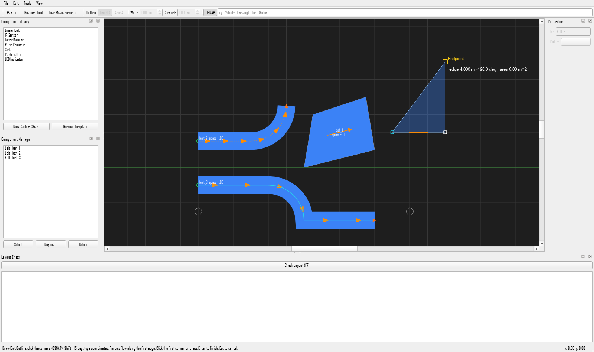
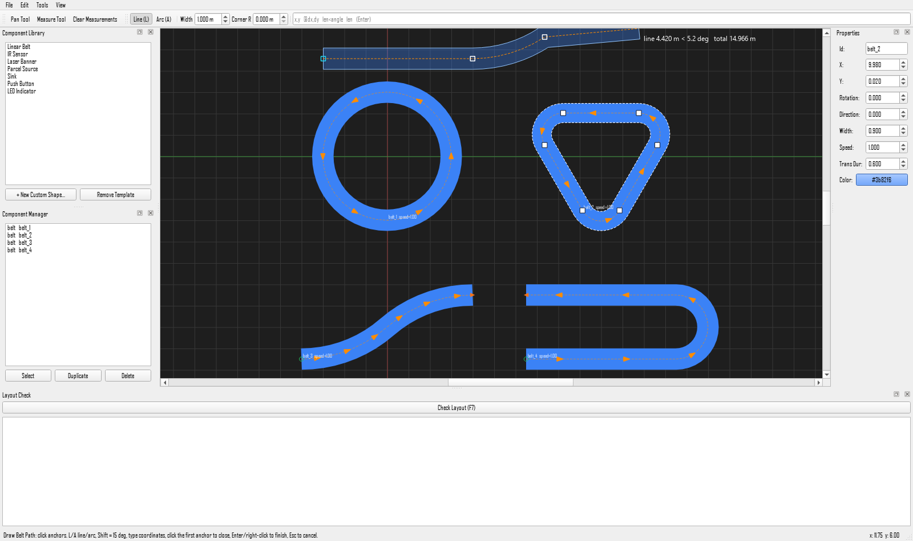

# Conveyor Flow Simulator - Python Engine

This directory contains the Python physics engine, visualizer, and PLC data-exchange
layer for the Conveyor Flow Simulator. It works in tandem with the React-based
frontend editor to simulate physical interactions between parcels, conveyor belts,
and sensors, and to exchange live I/O and metrics with a real or mock PLC over
MQTT or TCP.

## Architecture

The Python simulation runs as a standalone process that:
1. Parses a JSON configuration file generated by the React editor (`config_parser.py`).
2. Runs a 2D rigid-body physics simulation using Pymunk (`physics.py`).
3. Renders the simulation in a standalone window using Pygame (`visualizer.py` &
   `editor_ui.py`). Layouts are designed in the separate Qt layout editor
   (`layout_editor.py`, see [Designing layouts](#designing-layouts)).
4. Evaluates sensor triggers and drives kinematics (belts moving parcels).
5. Optionally exchanges I/O and metrics with a PLC (real or mocked) over MQTT or
   framed TCP, and optionally serves a browser-based editor + live dashboard for
   that exchange (see [Channel Registry Web UI](#channel-registry-web-ui) below).

### File Structure

**Core simulation**
- `main.py` - Entry point. Loads the config, builds the physics engine and the
  MQTT/TCP exchange engine, optionally starts the web UI, then runs the pygame
  GUI loop (or a headless loop).
- `physics.py` - The core Pymunk simulation. Handles belt kinematics, vertex-based
  impulse application, parcel collision, and sensor state evaluation.
- `visualizer.py` - The Pygame rendering loop. Draws belts, sensors, parcels, and
  selection highlights based on the simulation state.
- `editor_ui.py` - The Pygame GUI panel for viewing read-only properties of the
  selected component.
- `layout_editor.py` - PySide6 layout editor (design time only): Shape Designer,
  component library, alignment guides, undo/redo, copy/paste. Opens and saves
  layout JSON; does not run the simulation.
- `config_parser.py` - Loads the JSON config and deserializes it into typed Python
  dataclasses.
- `math_utils.py` / `id_utils.py` - Geometry helpers (e.g. ray casting for
  `point_in_polygon`) and crash-proof "next id" generation for new components.

**PLC data exchange (MQTT/TCP)**
- `mqtt_data_exchange.py` - `MQTTSyncEngine`: publish (simulator -> PLC) and
  subscribe (PLC -> simulator) channels, plus the hardcoded
  `PUBLISH_TOPICS`/`SUBSCRIBE_TOPICS`/`METRICS_CHANNELS` channel definitions used
  when no channel registry file is given.
- `mqtt_manager.py` - Thin MQTT client wrapper (`paho-mqtt`).
- `tcp_framed_transport.py` - The framed-TCP alternative transport (`FrameType`
  enum + length-prefixed frame read/write) for deployments without an MQTT broker.
- `mqtt_message_binding.py` - `ComponentMessage`/`MetricsMessage` binary
  packing/unpacking, and `custom_component_mapping()` (component id -> ByteType +
  padding), the single source of truth both the CLI tools and the web editor use.
- `metric_layout.py` - metric frame layouts as nested `@dataclass`es (one class
  per metric group, field widths via `f32`/`u16`/`u32`/`Vec2`/... aliases);
  `layout_mapping()` derives the wire `(ByteType, "group/name")` list
  `MetricsMessage` consumes. `mqtt_data_exchange.py`'s `METRICS_CHANNELS` declares
  each layout as one of these classes (`MetricLayout1`, ...).
- `mqtt_message_codec.py` / `struct_utils.py` - Lower-level struct pack/unpack
  helpers shared by the binding layer.
- `channel_registry.py` - Loads IO-mapping/metric channel definitions from an
  external `channels.json` instead of the hardcoded dicts in
  `mqtt_data_exchange.py`. Fully additive - only used when `--channel-registry`
  is given.
- `mqtt_data_exchange_codegen.py` - Reads and rewrites the hardcoded
  `PUBLISH_TOPICS`/`SUBSCRIBE_TOPICS`/`METRICS_CHANNELS` definitions in
  `mqtt_data_exchange.py` in place (metric layouts regenerated as `@dataclass`
  blocks) - the write path the web editor uses when no registry file is
  configured.
- `generate_frame_type.py` - Appends a new `FrameType` enum member to
  `tcp_framed_transport.py` for a metric channel's `frame_type` that doesn't have
  one yet, instead of hand-editing the enum.
- `validate_channel_registry.py` - CLI: check a `channels.json` (and the CSVs it
  references) against a simulator config without starting the simulator.
- `bootstrap_channel_csv.py` - CLI: generate a valid channel mapping CSV from a
  list of component ids.

**Live metrics dashboards**
- `metrics_store.py` - Thread-safe, bounded, grouped storage for client-reported
  metrics, fed by the exchange engine and read by the web dashboard below.
- `web_app.py` + `web_static/` - A Flask app serving the
  channel registry editor and a live metrics dashboard. See
  [Channel Registry Web UI](#channel-registry-web-ui).

**Test client**
- `plc_mock.py` - A mock PLC client for any layout over MQTT or TCP: runs the
  PLC program in `plc_logic.py` (Start/Stop buttons, parcel tracking, jam
  detection, belt speeds, LEDs) and reports its own measured performance as
  metrics - useful for exercising the Live Data tab below without real PLC
  hardware.

**Tests**
- `test_*.py` - One file per module above (`unittest`-based). Run the whole suite
  with `python -m unittest discover -s . -p "test_*.py"` (or `uv run` in front of
  that, see below).

## Coordinate Systems Unified

The simulation bridges mathematical 2D space, Pymunk physics space, React/Konva
screen space, and Pygame screen space. To ensure components align perfectly across
all domains, a **Unified Coordinate System** is used.

### 1. World Coordinate System (Standard Cartesian)
All `x` and `y` coordinates defined in the configuration JSON are treated as
**World Coordinates**:
- **Origin `(0, 0)`**: Fixed reference point.
- **X-Axis**: Increases to the **Right**.
- **Y-Axis**: Increases **Upwards** (Standard Cartesian).
- **Angles**: `0` degrees points Right (+X). `90` degrees points Up (+Y).
- **Rotation Direction**: Positive angles rotate **Counter-Clockwise (CCW)**.

### 2. Pygame / Konva Screen Coordinate System
Both the React frontend (Konva) and the Python visualizer (Pygame) render to
screens where the Y-axis is inverted:
- **X-Axis**: Increases to the Right.
- **Y-Axis**: Increases **Downwards**.

### 3. Rendering Rotation Alignment
Because the Screen Y-axis is inverted relative to the World Y-axis, rotating an
object mathematically can be tricky. However, the system is perfectly unified
because of how Pygame and Konva handle rotation:

- **Pygame (`pygame.transform.rotate(surf, angle)`)**: Rotates a surface CCW on
  the screen. Because the screen Y-axis is Down, a CCW rotation on the screen
  effectively rotates the +X axis towards the -Y axis (Up). This exactly mirrors
  the World CCW rotation! Therefore, we apply the raw `rotation` value directly
  to Pygame surfaces.
- **Konva**: Rotates surfaces CW by default. The React frontend passes
  `-rotation` to Konva, which reverses it to CCW, making it perfectly align with
  both World and Pygame.

### 4. Bounding Boxes and Dimensions
- **Linear Belts**: Have `length` (width) and `beltWidth` (height). At
  `rotation = 0`, they are horizontally aligned along the X-axis.
- **Sensors**: Have `width` and `height`. At `rotation = 0`, if a sensor is
  defined as `width = 0.1` and `height = 1.0`, it acts as a tall, vertical
  bounding box aligned along the Y-axis.
- **Sensor Beams (Laser Banners)**: Laser beams are always distributed along the
  local Y-axis of the sensor. In World space, when `rotation = 0`, the local
  Y-axis points UP `(0, 1)`. When rotated by `angle`, the local Y direction
  becomes `(-sin(angle), cos(angle))` due to the CCW rotation matrix.

## Designing layouts

```bash
# Open an existing layout (or give a new file name to start from scratch)
uv run python layout_editor.py test_config.json
```

The Qt layout editor is where belt shapes and positions are designed:

- **Component Library** dock: drag a component onto the canvas to place it.
  Built in: Linear Belt, Curved Belt, IR Sensor, Laser Banner, Parcel Source,
  Sink, Push Button, LED Indicator. Your own components sit below them:
  - **Add Selected** saves the component selected on the canvas (any kind: a
    belt of any type or shape - e.g. one made from a DXF -, a sensor, a
    button, ...) as a reusable template, with its size, rotation, speed,
    colour and bindings; **Update** overwrites the chosen template with the
    canvas selection; **Rename** / **Remove**. Built-ins can't be changed.
  - Your library is saved to `~/.conveyor_sim/component_library.json` after
    every change (or the file named by `CONVEYOR_COMPONENT_LIBRARY`) and is
    there again next time.
  - **Export...** writes your components to a library file, **Import...**
    adds the components of one (name clashes get a " (2)" suffix). The file
    format is in `component_library.py`.
  - **+ New Custom Shape...** opens the Shape Designer (freehand, triangle,
    quadrilateral or arc, with exact numeric parameters).
- **Alignment guides** snap to other components' vertices, edge midpoints and
  centers (also when rotated), plus a measure tool (D).
- Undo/redo, copy/paste, rubber-band multi-select, Component Manager and
  Properties docks.
- The same quiet dark style as the simulator. Canvas labels are upright tags
  of one small size at any zoom, shown only where they fit and never on top
  of each other (selected items first, then devices, then belt ids). Belt
  inlet/outlet markers are under View > Show Ports; connections are always
  marked (red when broken).


**CAD tools** (`layout_editor_cad.py` + the Qt-free `cad/` package):

| Action | Shortcut | What it does | Library |
|---|---|---|---|
| Tools > Connect Belts | Ctrl+J | Two belts selected: moves the downstream one so its inlet sits on the upstream outlet, heading continuous (tangent for curves) | planegcs |
| Tools > Fillet Belts... | Ctrl+Shift+F | Two straight belts: adds a curved belt of the given radius, tangent to both, trimming/extending the straights to meet it | planegcs |
| Tools > Disconnect Belts | Ctrl+Shift+J | Removes connections between the selected belts | |
| Tools > Solve Connections | F6 | Re-attaches every connection, holding the selected belts fixed | planegcs |
| Tools > Check Layout | F7 | Belt overlaps (transfer zones at belt ends are allowed), outlets leading nowhere, broken connections, sensors/sources not over a belt; double-click an issue to select it | Shapely |
| File > Import DXF Background... | | Floor plan as a locked background, via a dialog: units (prefilled from `$INSUNITS`, cross-checked against the drawing's dimensions), import only a window or one sheet of a drawing set, place it at the origin, leave out dimensions / hatches / leaders / layers | ezdxf |
| File > Background Settings... | | Change the background's units, window, offset and layers later (undoable) | ezdxf |
| File > Export DXF... | | Layout in metres, one layer per kind (BELTS, BELT_CENTERLINES, FLOW, SENSORS, ...) | ezdxf |
| View > Show Ports | | Inlet (green ring), outlet (orange arrow), connection (cyan ring; red = broken) | |

### CAD workflow: sketch (or import), then connect into belts



1. **Geometry first**, like any CAD tool:
   - **Tools > Sketch Line (S)** draws construction lines and tangent arcs
     (L / A), and **Tools > Sketch Arc (Shift+S)** draws a 3-point arc
     (start, end, a point on the arc).
   - Basic shapes: **Sketch Rectangle (Shift+R)** (two corners),
     **Sketch Circle (Shift+C)** (center, radius) and **Sketch Polygon
     (Shift+G)** (center, a corner; toolbar Sides). Corner R rounds the
     rectangle's and polygon's corners. Loop conveyors are built from these:
     sketch the shape, then make a belt along it or filling it (step 3).
   - Or **File > Import DXF Background...** a plant layout. Its lines, arcs,
     circles and polylines are read exactly (with arc bulges). Real drawings
     often need fixing on the way in, so the import dialog shows a preview
     and:
     - **Units**: m / cm / mm / inch / ft / unitless (typed scale), prefilled
       from `$INSUNITS`. The dimensions cross-check it: e.g. a dimension
       measuring 0.85 units shown as "85" (DIMLFAC 100) means metres drawn,
       centimetres shown, so a header saying inches is flagged (Use m).
     - **Import only a window**: pick a sheet (paper frames found in the
       drawing, named after their titles, or groups of geometry far apart)
       or drag a rectangle on the preview. Only geometry inside is loaded,
       which keeps a big drawing set fast.
     - **Placement**: the window's lower-left at (0, 0), or pick an origin
       point, or type the offsets. The result's size in metres is shown.
     - **Leave out** dimensions, hatches and leaders, and hide layers. What
       is left out is not drawn, snapped to or picked.

     The choices are saved in the layout's `background` (`scale`, `offsetX`,
     `offsetY`, `clip`, `skipTypes`, `hiddenLayers`); change them later with
     File > Background Settings...
2. **Every point you place snaps to existing geometry (OSNAP)**, on the
   drawing, the sketch and components. A yellow marker shows the snap before
   you click: Endpoint, Center, Midpoint or Nearest (on an edge), else Grid.
   The OSNAP toolbar button turns it off. Shift snaps the angle to 15 deg;
   typed `x,y`, `@dx,dy` and `len<angle` give exact points. A free click is
   only pixel-accurate, so type or snap points that must be exact.
3. **Connect geometry into a belt with Tools > Belt from Sketch/Drawing (B)**:
   - Click **on a line or arc** for a belt along it *and every line/arc
     joined to it end to end*, in any drawing direction (a branch stops the
     chain). The belt width comes from the toolbar's Width.
   - Click **inside a closed area**, even one bounded by separate lines, for
     a belt filling exactly that area (any shape, like a skewed merge
     feeder).
   - The toolbar's **Type** chooses the belt, and the preview shows it before
     you click:

     | Type | On a line / arc | In a closed area |
     |---|---|---|
     | Auto | straight -> Linear, an arc or circle -> Curved, anything else -> Path | arc-shaped -> Curved, else Linear |
     | Linear | a rectangle belt along a straight line | a polygon belt with that outline; parcels move one way |
     | Curved | a curved belt along an arc or circle | a ring sector, ring or disc bounded by concentric arcs, filled by a curved belt (parcels turn about the center) |
     | Path | a path belt along the whole chain | the middle arc of an arc-shaped area |

     **Direction** sets where parcels go, shown by the preview's arrows:
     Forward (along the line in its drawn order; in an area along its long
     axis, or counter-clockwise for curved), Reverse, or Across +/-90 deg
     (linear only). It can still be changed in Properties afterwards.
   - **Shapes split into parts**: line ends that miss each other by up to
     the toolbar's **Join gap** (default 2 cm) count as joined, both for
     lines and for closed areas, and a line drawn twice on top of itself
     doesn't stop a chain. When what you mean is still split (an area cut
     by a line, a chain through a branch), **Shift+click** each piece and
     press **Enter** for one belt: areas are merged, lines joined. Esc
     clears the pieces.

Sketch geometry is saved in the layout (`sketch`), exported to DXF on the
SKETCH layer, and ignored by physics. Select a sketch line and press Delete
to remove it, or use Tools > Clear Sketch. Shortcuts that skip the sketch
step:
- **Draw Belt Outline (O)**: click the corners of any polygon. The first edge
  sets the flow direction.
- **Draw Belt Path (P)** (below).

Selecting a polygon belt shows its corner handles: drag one to move it,
Shift+click to insert a corner, Alt+click to delete one.

### Drawing belts (path belts)



**Tools > Draw Belt Path (P)** draws a belt along any path:

| Input | Effect |
|---|---|
| click | add an anchor (snaps to component key points and the grid) |
| Shift | segment angle snaps to 15 deg steps |
| L / A (or the toolbar) | following segments are straight lines / tangent arcs |
| typing `x,y` `@dx,dy` `len<angle` `len` + Enter | exact anchor (absolute, relative, polar, or along the cursor direction) |
| click the first anchor (or C) | close the path into a loop conveyor |
| Enter / right-click / double-click | finish an open path |
| Backspace / Esc | remove the last anchor / cancel |

The live preview shows the belt surface, the current segment's length and
angle, and the total length. When the path is finished, sharp corners are
rounded with the toolbar's **Corner R** (0 = keep them sharp, mitred).
For loops of standard shapes, sketch a rectangle, circle or polygon and
use Belt from Sketch/Drawing with Type Path (on its outline) instead.

Select a drawn belt to edit its anchors: drag a handle to move it,
Ctrl+click to switch the segment after it between straight and tangent arc,
Shift+click to insert an anchor, Alt+click to delete one. Everything is undoable.

How it's stored and simulated (`cad/path.py`): a path belt is `type: "path"`
with `path: [{x, y, bulge}, ...]` (local to the belt's `x`/`y`/`rotation`) and
`closed`. `bulge` is the DXF polyline convention (0 = straight,
tan(sweep/4) = arc), so arcs are exact and export to DXF as native bulge
polylines. The belt surface is the centerline offset by half the belt width
on each side (Shapely); a loop is a ring. In the simulator, a point on the
belt moves along the nearest centerline piece at belt speed, and arc pieces
turn rigidly about their center like a curved belt, so parcels keep their
orientation through curves (kinematic and friction traction). The layout
check flags curves tighter than half the belt width. Path belts can't be
used with Connect/Fillet (the constraint solver handles straight and curved
belts); draw the joint into the path instead.

Connections are saved in the layout (`connections`) and kept while editing:
dragging a belt moves every belt connected to it, in the same undo step. The
background reference is saved as `background` (`path` relative to the layout,
`scale` in metres per drawing unit, `offsetX`/`offsetY` in metres).

File > Save writes back to the opened file and keeps everything the editor
doesn't edit (drive settings, `tractionModel`, exchange settings). Then run it:
`python main.py <layout.json>`. The editor doesn't run the simulation itself:
its per-frame rendering of moving parcels measured ~9x slower than pygame's
(22.8 ms vs 2.6 ms), so the simulator runs in the pygame app.

## Running the Simulation

```bash
# Pygame GUI, with a specific configuration file
python main.py test_config.json

# Headless (no window at all)
python main.py test_config.json --headless
```


The window follows an operator-panel style (`hmi_style.py`, shared with the
layout editor): a quiet grey canvas, colour only for state - green running /
clear, red blocked / fault, amber paused. The status bar shows run state,
simulated time, the real-time ratio, parcels in flight and delivered, drive
faults and the PLC link (`PLC 1 link`, or `LAYOUT mismatch` when its frames
don't fit). Running belts show flow chevrons; a tripped drive gets a red
outline and a FAULT tag. Labels are small, upright tags placed by priority
(faults, then devices, then belt ids); a label that would overlap another is
left out until you zoom in, and the selected item always shows its tag and
coordinates. `V` toggles the per-parcel speed readout (actual / belt speed).

Add `--exchange-config <file.json>` to override the MQTT/TCP settings baked into
the workspace config (see `tcp_exchange_config.json` for the shape).

Add `--sim-thread` when a PLC is connected: physics and the exchange then run on
their own 2 ms tick (`sim_runner.py`) instead of once per GUI frame, so a 10 ms
channel really goes out every 10 ms. `--headless` always runs this way.

### Belt drives, traction, and timing

See [drive_traction_plan.md](drive_traction_plan.md) for the design.

- **Fixed step.** Physics, drives and sensors advance in fixed `physicsDt` steps
  (default 4 ms) regardless of frame rate. Sensors count `risingEdges`, so the
  PLC can see a pulse shorter than the exchange interval.
- **Belt drive** (`drive.py`). The PLC's command is the setpoint. An optional
  `"drive": {"accel", "decel", "tau", "speedMax", "countsPerM", "maxLoad",
  "overloadTime", "atSpeedTolerance", "runningThreshold"}` turns it into
  `actualSpeed` (ramp + first-order lag), a UINT32 `encoderCount` that wraps
  and status bits. A belt without `drive` changes speed instantly, as before.
- **Traction** (`traction.py`). With `"tractionModel": "friction"`, parcels are
  dragged by friction capped at `Belt.friction` × m × g (`floorFriction` off belts),
  so starts, stops, slip and pushing come from physics. The default `"kinematic"`
  model is the original velocity-override behavior.
- **Belt feedback to the PLC.** Set `mqttSettings.beltFeedback: true` to publish
  every belt's status bits (`running`, `atSpeed`, `reversing`, `fault`), then per
  belt `actualSpeed` (REAL) + `encoderCount` (DWORD), in config order, as a
  `FrameType.BELT_FEEDBACK` (6) frame every `beltFeedbackIntervalMs`.
  It is off by default: the PLC must check the frame type byte before
  deserializing, or this frame overwrites its IO_MAPPING input struct.
  In channel registry files, a belt in an `"out"` (simulator → client) channel
  maps to these feedback fields, and `clock/simNanoseconds` gives simulated time.

### Field devices

How the simulated devices behave (`devices.py`, `drive.py`, `physics.py`):

| Device | Settings | Behaviour |
|---|---|---|
| IR sensor (`sensorType: "ir"`) | `onDelay`, `offDelay` (s), `invert` | 1 while a parcel is in the sensor's footprint (dark-on). `onDelay` ignores shorter blockages (flicker, gaps), `offDelay` stretches short pulses, `invert` gives a light-on / NC output (1 while clear). `risingEdges` counts detections. |
| Laser banner (`"laser_banner"`) | `laserCount`, `beamDistance`, the same timing / `invert` per beam | one bit per beam (beam *i* = bit *i*), each beam a segment across the sensor; `blockedBeams` (runtime) is how many are blocked - a parcel's size across the belt. |
| Push button | `buttonType` "momentary" / "latching", `normallyClosed`, `key` | Click (or hold its `key` in the simulator window) to press. Momentary: pressed while held; latching (selector, E-stop): toggles per press. An NC contact (STOP / E-stop) reads 1 until pressed. |
| LED | `packFormat` "bit" / "byte" | "bit": the PLC switches `isOn`. "byte": the PLC sends a mode - 0 off, 1 on, 2 blink 1 Hz, 3 blink 4 Hz. |
| Belt motor, command | `commandFormat` "speed" / "vfd" | "speed": `speed` (signed, negative = reverse) + `directionAngle` REALs. "vfd": `run` + `reverse` BOOLs and `speed` (REAL, magnitude), like a frequency converter. |
| Belt motor, feedback | `drive` (above) | `running`, `atSpeed`, `reversing`, `fault`, `actualSpeed`, `encoderCount`. **Overload**: parcels on the belt heavier than `maxLoad` kg for `overloadTime` s trip the drive - it coasts to a stop and resets when the run command is removed. A faulted belt has a red outline in the simulator window. |

`plc_mock.py`'s program (`plc_logic.py`) understands all of these: NC buttons,
light-on sensors, vfd belts, and a drive fault in the feedback stops the line
until it has reset and Start is pressed.

`test_config.json` is Station_1 of the SIMATIC AX project: three lanes (an IR
sensor on lane 1, 32-beam laser banners on lanes 2 and 3) merging into lane 1
and the outfeed to `sink_4`; START / STOP / RESET buttons and AUTO / MANUAL /
ERROR LEDs per lane, with keys `1 2 3` (START), `q w e` (STOP), `a s d`
(RESET); the PLC-commanded belts have drive models with overload protection
and stand still until the PLC runs them. Its I/O frames are exactly the AX
project's `Station_1_Input` / `Station_1_Output`, so its belts use the
"speed" command format and `beltFeedback` stays off (the AX client
deserializes every frame as I/O). `test_fixture_config.json` is the old,
larger layout that unit tests use as a collection of every component variant.

To also start the channel registry editor + live metrics dashboard alongside the
simulator, add `--web-ui` (see [Channel Registry Web UI](#channel-registry-web-ui)):

```bash
python main.py test_config.json --web-ui
# with a channel registry file instead of the hardcoded exchange definitions:
python main.py test_config.json --channel-registry channels.json --web-ui
```

### Mock PLC client

A mock PLC for any layout, over the same TCP (or MQTT) exchange a real PLC
uses. It receives every button and sensor, runs a small PLC program
(`plc_logic.py`) and sends belt speeds and LEDs back, and reports its own
performance as metrics for the web dashboard:

```bash
python plc_mock.py test_config.json
```

The PLC program, every `--scan` (default 50 ms):
- **Buttons** by label: START runs the belts, STOP stops them, RESET clears a
  jam (unlabelled: one button toggles; with two, the first starts and the
  second stops).
- **Sensors**: every parcel passing a sensor is counted; the sensor nearest a
  sink counts deliveries. A sensor blocked longer than `--jam-time`
  (default 5 s) is a jam: belts stop until the parcel is gone and Start or
  Reset is pressed.
- **Belts** run at their speed from the layout file (1 m/s where it is 0)
  while running. **LEDs** by label: RUN (else the first LED) shows running,
  JAM/FAULT/ALARM (else the second) a jam. `--autostart` runs without Start.

### I/O frame layout

Each IO_MAPPING frame is a packed struct, no alignment, in the exchange's
byte order (`endianness`, LE by default). The layout follows the SIMATIC AX
serializer (`tools/generate_st_serde.py`): every single bit first, padding
to a whole byte, then every other field in declaration order.

| Field | Wire | PLC type |
|---|---|---|
| button, IR sensor, LED (`packFormat` "bit") | 1 bit, 8 per byte, bit 0 first | BOOL |
| padding | unused bits up to the byte | - |
| laser banner ("bit") | its beams, beam *i* = bit *i*, padded to whole bytes | BYTE / WORD / DWORD / LWORD, else ARRAY OF BYTE |
| `packFormat` "byte" / "uint16" / "uint32" / "float" | 1 / 2 / 4 / 4 bytes (a banner's beam *i* = bit *i* here too) | BYTE / WORD / DWORD / REAL |
| belt command (output) | speed, directionAngle: 2 x 4-byte float | ARRAY[0..1] OF REAL |
| belt feedback (BELT_FEEDBACK frame) | actualSpeed float, encoderCount uint32 | REAL, DWORD |
| clock | uint64 nanoseconds (wall clock) | LINT |

```bash
# Offset table (byte.bit, type, PLC type) of a layout's input and output frames,
# and the matching STRUCTs for the PLC project
python io_layout.py delivery.json --st
```

The simulator prints each channel's size and layout fingerprint (a CRC-32
of offsets, types and names) when it starts - `main.py --show-layout`
prints the full tables - and `plc_mock.py` prints its own
(`--show-layout` for tables and STRUCTs). When `plc_mock.py` connects over
TCP it sends a LAYOUT_CHECK frame (frame type 7) with its fingerprints; the
simulator compares them with its own and both log `I/O layout check: OK` or
a MISMATCH naming the frame (input/output) and both sizes. Frames of the
wrong size are ignored, counted (`rx_size_errors` in the exchange stats)
and reported every few seconds, never applied.

### Workflow: a parcel delivery line, designed to controlled

1. `python layout_editor.py delivery.json` - File > Import DXF Background...
   the hall plan (units, one sheet, origin); place linear and curved belts,
   IR sensors, a Parcel Source, a Sink, Push Buttons labelled START / STOP
   and LEDs labelled RUN / JAM from the Component Library; set the belts'
   design speed in Properties; save.
2. `python main.py delivery.json --exchange-config tcp_exchange_config.json`
   - the simulator, serving the I/O over TCP.
3. `python plc_mock.py delivery.json --exchange-config tcp_exchange_config.json`
   - the PLC: it prints its inputs, outputs and which button/LED does what.
4. Click START in the simulator window: the belts run, and the PLC log shows
   each parcel at each sensor and the deliveries. STOP stops the line.

No channel setup is needed: a layout that doesn't have `test_config.json`'s
component ids gets its I/O image from its own components
(`mqtt_data_exchange.io_topics`): input = every button, every sensor, the
clock; output = every LED, every belt - the simulator and `plc_mock.py`
build the same one. `test_delivery_workflow.py` runs this whole workflow,
with the real `plc_mock.py` process, as a test.

### Standalone validation/codegen tools

These work directly on a `channels.json` + CSVs, without starting the simulator
or the web UI - the same checks/output the web editor uses under the hood:

```bash
# Check a registry (and the CSVs it references) against a config
python validate_channel_registry.py --registry channels.json --config sim_config.json

# Generate a starting CSV for a new channel from a list of component ids
python bootstrap_channel_csv.py --config sim_config.json --ids belt_1,sensor_1 --out channels/new_channel.csv
```

## Channel Registry Web UI

`web_app.py` serves a browser-based editor for the simulator's PLC I/O-mapping and
metric channels, plus a live view of whatever metrics a connected client (the
simulator itself, or `plc_mock.py`) is reporting - replacing hand-edited
JSON/CSV/Python dicts and a separate CLI validate step with immediate, per-row
feedback as you type. Every check it reports comes from the exact same functions
the CLI tools and `MQTTSyncEngine` itself use (`verify_component_list`,
`parse_mapping_rows`, `channel_registry.validate_entries`) - the browser is
presentation only, never a second implementation of what's valid.

### Starting it

```bash
# Embedded: alongside a running simulator, sharing its live MetricsStore
python main.py test_config.json --web-ui --web-host 127.0.0.1 --web-port 5050

# Standalone: registry editor only, no live simulator/metrics
python web_app.py --config sim_config.json --registry channels.json
```

Then open `http://127.0.0.1:5050` (or whatever `--web-host`/`--web-port`, or
`web_app.py --host`/`--port`, you gave it).

`--web-host`/`--web-port` default to `127.0.0.1:5050`; bind `--web-host 0.0.0.0`
to reach it from another machine on the network.

### Two channel-definition sources

- **`--channel-registry channels.json` given**: the editor reads/writes that file.
  Missing it creates a new one on first save; nothing else on disk is touched.
- **`--channel-registry` omitted**: the editor reads/writes the hardcoded
  `PUBLISH_TOPICS`/`SUBSCRIBE_TOPICS`/`METRICS_CHANNELS` dicts directly in
  `mqtt_data_exchange.py` (via `mqtt_data_exchange_codegen.py`). Saving rewrites
  that file in place - the **previous version is always backed up as
  `mqtt_data_exchange.py.bak`** first, and the new source is compiled and
  re-validated (`validate_entries`) before anything is written, so a bad edit
  never reaches disk. Either way, **the running simulator process (and any other
  already-running one) needs a restart to pick up the change** - Python doesn't
  hot-reload a module it already imported.

### Channels tab

- Pick an existing channel from the list on the left, or **+ New** to start one.
- **`io_mapping`** channels use the component picker: add component ids from the
  current config's catalog (sensors, buttons, LEDs, belts, the shared `clock`) and
  reorder them with the up/down arrows - the server decides each one's `ByteType`
  and any padding from its own `packFormat`, the same way the CLI tools build it.
  Nothing in the rows table is hand-edited here.
- **`metric`** channels are hand-authored: **+ Add row** appends a field (`Group`
  is what the Live Data tree branches on, `Type` is the PLC-style register width
  it packs as on the wire). A run of `BIT` rows auto-shares one byte. In hardcoded
  mode, saving regenerates the channel as a nested `@dataclass` metric layout in
  `mqtt_data_exchange.py` (`metric_layout.py`) - one class per `Group`, one typed
  field per row; `plc_mock.py` fills an instance of that class and hands it
  straight to `MetricsMessage.serialize()`.
- The status line below the fields shows per-row validation errors live, or the
  final payload size once the channel is valid. An "unknown frame_type" error
  comes with a **Generate FrameType** button that calls `generate_frame_type.py`
  for you.
- **Save registry** writes every channel at once (only if every channel is valid)
  - see backup/restart notes above for what "save" actually does in each mode.

### Live Data tab

- The metrics tree on the left lists every group/metric the connected client has
  reported so far (empty, with a "No live simulator connected" notice, if nothing
  is feeding the shared `MetricsStore` - run the simulator with `--web-ui`, or
  point `plc_mock.py` at it, to populate it). Type into the filter box above the
  tree to narrow it by group or metric name.
- Check a metric to plot it. The chart (Chart.js, vendored locally in
  `web_static/vendor/` - no CDN, no internet access needed) gives each checked
  metric its own auto-scaled axis, so a running counter and a millisecond-scale
  metric can be plotted together without one drowning the other; hovering shows
  every plotted value at that moment.
- **From**/**To** and **Follow latest** control the visible time window - Follow
  latest (checked by default) slides a fixed-width window forward as new data
  arrives; editing From or To by hand freezes the view at exactly that range.
- The table below the chart always shows the latest value of every reported
  metric, whether or not it's checked for plotting.

## Running Tests

```bash
python -m unittest discover -s . -p "test_*.py"
# or, using the project's uv-managed environment:
uv run python -m unittest discover -s . -p "test_*.py"
```
